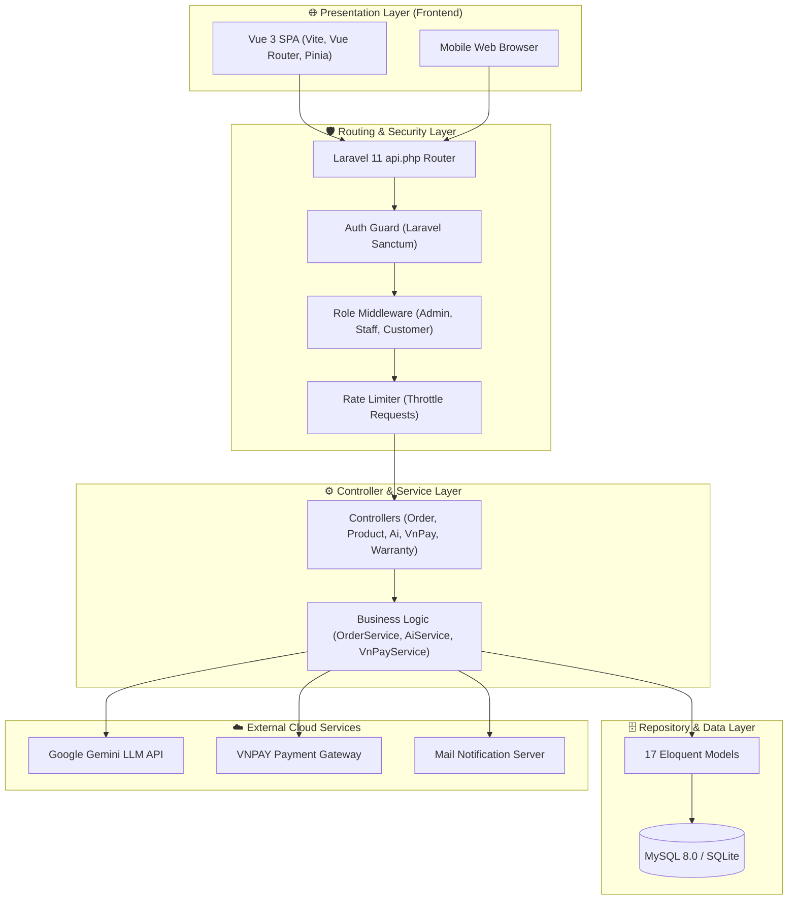
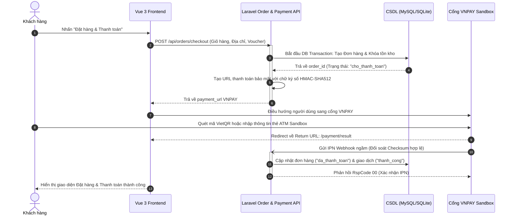
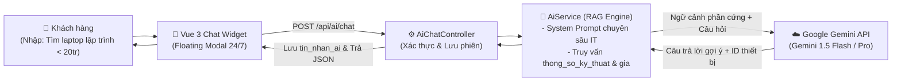

# ⚡ TECHMART AI - HỆ THỐNG BÁN THIẾT BỊ ĐIỆN TỬ THÔNG MINH
### *Đồ Án CDIO 4 (SE447 G) - Website E-Commerce Tích Hợp Trợ Lý Ảo AI Tư Vấn Cấu Hình & Cổng Thanh Toán VNPAY*

<p align="center">
  
  
  
  
  
  
  
  
</p>

---

## 📖 MỤC LỤC
1. [Giới thiệu Dự án](#-giới-thiệu-dự-án)
2. [Điểm nhấn Công nghệ Cốt lõi](#-điểm-nhấn-công-nghệ-cốt-lõi)
3. [Đội ngũ Phát triển & Phân vai (Nhóm 2)](#-đội-ngũ-phát-triển--phân-vai-nhóm-2)
4. [Sơ đồ Kiến trúc & Quy trình Nghiệp vụ](#-sơ-đồ-kiến-trúc--quy-trình-nghiệp-vụ)
   - [4.1 Kiến trúc Phân tầng Hệ thống](#41-kiến-trúc-phân-tầng-hệ-thống)
   - [4.2 Quy trình Đặt hàng & Thanh toán VNPAY Sandbox](#42-quy-trình-đặt-hàng--thanh-toán-vnpay-sandbox)
   - [4.3 Kiến trúc Trợ lý ảo AI Tư vấn Cấu hình](#43-kiến-trúc-trợ-lý-ảo-ai-tư-vấn-cấu-hình-gemini-api)
   - [4.4 Quy trình Quản lý Serial/IMEI & Bảo hành Điện tử](#44-quy-trình-quản-lý-serialimei--bảo-hành-điện-tử)
5. [Cấu trúc Thư mục Toàn dự án (Monorepo)](#-cấu-trúc-thư-mục-toàn-dự-án-monorepo)
6. [Mô hình Cơ sở Dữ liệu (17 Bảng Chuẩn hóa)](#-mô-hình-cơ-sở-dữ-liệu-17-bảng-chuẩn-hóa)
7. [Danh mục API Endpoints Chính](#-danh-mục-api-endpoints-chính)
8. [Hướng dẫn Cài đặt & Khởi chạy (Fullstack Quick Start)](#-hướng-dẫn-cài-đặt--khởi-chạy-fullstack-quick-start)
   - [8.1 Khởi chạy Backend (Laravel 11)](#81-khởi-chạy-backend-laravel-11)
   - [8.2 Khởi chạy Frontend (Vue 3 + Vite)](#82-khởi-chạy-frontend-vue-3--vite)
   - [8.3 Tài khoản Quản trị & Trải nghiệm](#83-tài-khoản-quản-trị--trải-nghiệm)
9. [Công nghệ Sử dụng](#-công-nghệ-sử-dụng)

---

## 📌 GIỚI THIỆU DỰ ÁN

**TECHMART AI** là nền tảng thương mại điện tử chuyên biệt cho ngành thiết bị công nghệ (Laptop Gaming, Ultrabook, Smartphone, Linh kiện PC, Thiết bị ngoại vi), được phát triển trong khuôn khổ học phần **Đồ án CDIO 4 (SE447 G)**.

Hệ thống kết hợp mô hình Frontend hiện đại (**Vue 3 Composition API**) với Backend mạnh mẽ (**Laravel 11 RESTful API**), tích hợp công nghệ AI tạo sinh (**Google Gemini API**) và cổng thanh toán quốc gia (**VNPAY Sandbox**):

- 🛒 **Trải nghiệm Khách hàng (Storefront):** Tìm kiếm thông minh, lọc cấu hình theo thông số kỹ thuật chi tiết (CPU, RAM, GPU, ổ cứng), tư vấn trực tiếp 24/7 từ Trợ lý AI, thanh toán bảo mật với VNPAY QR/ATM/Thẻ tín dụng, và kiểm tra lịch sử bảo hành theo mã Serial/IMEI.
- ⚡ **Quản trị Bán hàng & Chăm sóc (Sales & CSKH):** Tiếp nhận đơn hàng theo thời gian thực, quản lý trạng thái xử lý đơn, phát hành Voucher chiết khấu và kiểm duyệt bình luận/đánh giá.
- 🏷️ **Quản lý Kho & Bảo hành Vật lý (Inventory & Warranty):** Cấp phát và theo dõi từng chiếc máy vật lý bằng dải mã Serial/IMEI riêng biệt, tự động kích hoạt bảo hành điện tử ngay sau khi xuất kho.
- 📊 **Phân tích Doanh nghiệp (Admin Dashboard):** Bảng thống kê doanh thu, tỷ lệ chuyển đổi, top sản phẩm bán chạy và quản lý phân quyền người dùng (RBAC).

---

## ✨ ĐIỂM NHẤN CÔNG NGHỆ CỐT LÕI

| Tính năng cốt lõi | Mô tả giải pháp kỹ thuật |
|:---|:---|
| 🤖 **Trợ lý AI Tư vấn Cấu hình** | Ứng dụng **Google Gemini API** kết hợp kỹ thuật **RAG (Retrieval-Augmented Generation)** nội bộ. AI đọc dữ liệu thông số kỹ thuật phần cứng thực tế trong CSDL để đưa ra khuyến nghị chính xác theo ngân sách và mục đích sử dụng (học tập, đồ họa, gaming, văn phòng). |
| 💳 **Thanh toán Trực tuyến VNPAY** | Tích hợp **VNPAY Sandbox** với thuật toán mã hóa chữ ký số chuẩn **HMAC-SHA512**. Xử lý đối soát giao dịch an toàn qua cơ chế **Webhook IPN (Instant Payment Notification)** chạy ngầm tự động. |
| 🏷️ **Quản lý Serial/IMEI Độc bản** | Quản lý vòng đời từng chiếc máy từ lúc nhập kho (`san_sang_ban`), xuất bán gán vào đơn hàng (`da_ban`) cho đến khi kích hoạt bảo hành điện tử và tiếp nhận sửa chữa/đổi trả (`bao_hanh`). |
| ⚡ **Kiến trúc Clean Architecture** | Tách biệt triệt để Controller, Service Layer và Eloquent Repository Pattern trên nền Laravel 11 giúp mã nguồn linh hoạt, dễ mở rộng và kiểm thử tự động với PHPUnit. |

---

## 👥 ĐỘI NGŨ PHÁT TRIỂN & PHÂN VAI (NHÓM 2)

> **Học phần:** Đồ án Công nghệ Thông tin / Kỹ thuật Phần mềm (SE447 G) - **Đại học Duy Tân**  
> **Giảng viên hướng dẫn:** ThS. Nguyễn Phúc Minh Tú

| STT | Họ và Tên | Vai trò Scrum | Nhiệm vụ chuyên môn chính |
|:---:|:---|:---|:---|
| 1 | **Nguyễn Văn Kỳ** | **Scrum Master / Tech Lead** | Thiết kế kiến trúc tổng thể, Xác thực Token Sanctum, Phân quyền RBAC, Tích hợp AI Engine (Gemini API) & Quản lý Git. |
| 2 | **Võ Đình Huy** | **Backend Developer** | Thiết kế CSDL 17 bảng tiếng Việt, Eloquent ORM, Quản lý Danh mục, Sản phẩm, Biến thể cấu hình & Module Serial/IMEI. |
| 3 | **Lê Quốc Khánh** | **API Specialist** | Xử lý Giỏ hàng, Quy trình Checkout đơn hàng, Áp dụng Voucher & Tích hợp cổng thanh toán trực tuyến VNPAY. |
| 4 | **Phạm Tiến Ninh** | **Fullstack Developer** | Xây dựng Giao diện Frontend (Vue 3, Vue Router), Quản lý Hồ sơ tài khoản, Sổ địa chỉ và Module Đánh giá. |
| 5 | **Dương Văn Trọng Đại** | **QA / Tester & BI** | Thiết kế kịch bản kiểm thử, viết Unit/Feature Tests (PHPUnit), kiểm thử tải API và Xây dựng Báo cáo Thống kê BI. |

---

## 🏛️ SƠ ĐỒ KIẾN TRÚC & QUY TRÌNH NGHIỆP VỤ

### 4.1 Kiến trúc Phân tầng Hệ thống

<p align="center">
  
</p>



---

### 4.2 Quy trình Đặt hàng & Thanh toán VNPAY Sandbox

<p align="center">
  
</p>



---

### 4.3 Kiến trúc Trợ lý ảo AI Tư vấn Cấu hình (Gemini API)

<p align="center">
  
</p>



---

### 4.4 Quy trình Quản lý Serial/IMEI & Bảo hành Điện tử

<p align="center">
  
</p>

- 📥 **Giai đoạn Nhập kho:** Mỗi chiếc máy vật lý khi nhập kho được cấp một mã Serial/IMEI độc nhất với trạng thái `san_sang_ban`.
- 📦 **Giai đoạn Xuất bán:** Nhân viên đóng gói quét gán mã Serial/IMEI vào từng sản phẩm trong đơn hàng. Hệ thống tự động chuyển trạng thái máy thành `da_ban` và bắt đầu kích hoạt hạn bảo hành điện tử (12 - 24 tháng).
- 🔍 **Giai đoạn Tra cứu:** Khách hàng hoặc kỹ thuật viên có thể tra cứu hạn bảo hành trực tuyến tại `GET /api/warranty/check?serial={code}` mà không cần giữ phiếu bảo hành giấy.

---

## 📁 CẤU TRÚC THƯ MỤC TOÀN DỰ ÁN (MONOREPO)

```
DoAnCdio_4/
├── be_nhom2_qlbtbdt/             # BACKEND APPLICATION (Laravel 11)
│   ├── app/
│   │   ├── Http/Controllers/     # RESTful API Controllers
│   │   ├── Models/               # 17 Eloquent Models
│   │   └── Services/             # Business Logic (Order, VnPay, AiService)
│   ├── database/
│   │   ├── migrations/           # 17 Database Migrations
│   │   ├── seeders/              # Dữ liệu mẫu phong phú
│   │   └── database.sqlite       # Cơ sở dữ liệu mặc định
│   ├── routes/
│   │   └── api.php               # Danh mục toàn bộ API routes
│   ├── tests/                    # Unit & Feature Test cases
│   ├── composer.json             # PHP Dependencies
│   └── .env.example              # Mẫu cấu hình môi trường Backend
│
├── fe_nhom2_qlbtbdt/             # FRONTEND APPLICATION (Vue 3 + Vite)
│   ├── src/
│   │   ├── assets/               # CSS, Icons, Hình ảnh
│   │   ├── components/           # UI Components (Admin, Auth, Cart, Home)
│   │   ├── router/               # Vue Router cấu hình điều hướng
│   │   ├── utils/                # Axios API Client instance
│   │   ├── views/                # Các trang chính (Home, About, ...)
│   │   ├── App.vue               # Root Vue Component
│   │   └── main.js               # Entry Point
│   ├── package.json              # NPM Dependencies
│   └── vite.config.js            # Vite Configuration
│
├── docs/                         # TÀI LIỆU & HÌNH ẢNH DỰ ÁN
│   └── images/                   # Sơ đồ kiến trúc & luồng nghiệp vụ
├── .gitignore                    # Cấu hình Git Ignore toàn hệ thống
└── README.md                     # Tài liệu tổng quan dự án
```

---

## 🗄️ MÔ HÌNH CƠ SỞ DỮ LIỆU (17 BẢNG CHUẨN HÓA)

| STT | Tên bảng | Chức năng nghiệp vụ chính |
|:---:|:---|:---|
| 1 | `nguoi_dung` | Tài khoản người dùng, email, mật khẩu mã hóa Bcrypt, phân quyền (`admin`, `staff`, `customer`). |
| 2 | `dia_chi_nguoi_dung` | Sổ địa chỉ giao hàng của khách hàng (hỗ trợ nhiều địa chỉ, có gắn cờ mặc định). |
| 3 | `thuong_hieu` | Danh sách các hãng công nghệ lớn (Apple, Asus, Dell, HP, Lenovo, MSI, Samsung...). |
| 4 | `danh_muc` | Cây phân cấp danh mục thiết bị cha - con (Laptop, Điện thoại, Linh kiện, Phụ kiện). |
| 5 | `san_pham` | Thông tin gốc: Tên, mã sản phẩm, giá niêm yết, thời gian bảo hành và mô tả chi tiết. |
| 6 | `hinh_anh_san_pham` | Bộ sưu tập ảnh sản phẩm đa góc nhìn. |
| 7 | `thong_so_ky_thuat` | Cấu hình chi tiết: CPU, RAM, GPU, Ổ cứng, Màn hình, Pin, Trọng lượng & JSON mở rộng cho AI. |
| 8 | `bien_the_san_pham` | Tùy chọn cấu hình/màu sắc (RAM 16GB/32GB, SSD 512GB/1TB), SKU, giá bán lẻ và tồn kho. |
| 9 | `serial_san_pham` | Quản lý từng mã Serial/IMEI vật lý phục vụ bảo hành điện tử chính xác. |
| 10 | `ma_giam_gia` | Quản lý Voucher khuyến mãi theo % hoặc số tiền cố định, thời hạn sử dụng. |
| 11 | `don_hang` | Quản lý đơn hàng, thông tin người nhận, trạng thái vận chuyển và tổng thanh toán. |
| 12 | `chi_tiet_don_hang` | Danh sách từng sản phẩm/biến thể trong đơn hàng và giá bán thực tế. |
| 13 | `thanh_toan` | Nhật ký giao dịch: Mã thanh toán VNPAY, phương thức (COD/VNPAY) và trạng thái. |
| 14 | `gio_hang` | Giỏ hàng lưu trữ của khách hàng đã đăng nhập và khách vãng lai. |
| 15 | `danh_gia` | Đánh giá 1 - 5 sao và nhận xét phản hồi thực tế từ người mua. |
| 16 | `hoi_thoai_ai` | Quản lý các phiên trò chuyện tư vấn giữa khách hàng và Trợ lý AI. |
| 17 | `tin_nhan_ai` | Chi tiết câu hỏi của khách hàng và nội dung đề xuất kèm danh sách ID máy từ Gemini AI. |

---

## 🔌 DANH MỤC API ENDPOINTS CHÍNH

### 1. Xác thực & Tài khoản (`/api/auth`)
- `POST /api/auth/register` : Đăng ký tài khoản khách hàng mới.
- `POST /api/auth/login` : Đăng nhập hệ thống, cấp Sanctum Token.
- `POST /api/auth/logout` : Đăng xuất và thu hồi token hiện tại.
- `GET  /api/auth/me` : Lấy thông tin tài khoản và quyền hạn đang đăng nhập.

### 2. Sản phẩm & Mua sắm (`/api`)
- `GET  /api/categories` : Lấy danh mục sản phẩm phân cấp.
- `GET  /api/brands` : Lấy danh sách các thương hiệu.
- `GET  /api/products` : Lấy danh sách sản phẩm (có phân trang & sắp xếp).
- `GET  /api/products/filter` : Bộ lọc kỹ thuật đa tiêu chí (CPU, RAM, GPU, Hãng, Mức giá).
- `GET  /api/products/{slug}` : Chi tiết sản phẩm kèm cấu hình kỹ thuật & biến thể.
- `GET  /api/cart` : Xem giỏ hàng hiện tại.
- `POST /api/cart/add` : Thêm sản phẩm vào giỏ hàng (kiểm tra tồn kho tự động).
- `POST /api/vouchers/apply` : Áp dụng mã giảm giá.
- `POST /api/orders/checkout` : Tạo đơn hàng mới an toàn với DB Transaction.
- `POST /api/payment/vnpay/create-url` : Tạo URL thanh toán VNPAY mã hóa HMAC-SHA512.
- `GET  /api/payment/vnpay/ipn` : Webhook nhận thông báo giao dịch ngầm tự động từ VNPAY.
- `GET  /api/warranty/check?serial={code}` : Tra cứu bảo hành điện tử công khai theo Serial/IMEI.

### 3. Trợ lý AI Tư vấn Cấu hình (`/api/ai`)
- `POST /api/ai/chat` : Gửi yêu cầu tư vấn, AI phân tích nhu cầu và trả lời kèm danh sách sản phẩm.
- `GET  /api/ai/history` : Lấy lại lịch sử trò chuyện tư vấn của phiên người dùng.

### 4. Quản trị Phân hệ Admin (`/api/admin`)
- `GET  /api/admin/analytics/overview` : Tổng quan doanh thu, số đơn hàng và tăng trưởng.
- `CRUD /api/admin/products` : Quản lý thêm, sửa, xóa sản phẩm và biến thể.
- `GET  /api/admin/orders` : Danh sách đơn hàng toàn hệ thống & cập nhật trạng thái.
- `POST /api/admin/orders/{id}/assign-serial` : Gán mã Serial/IMEI vật lý trước khi xuất kho.

---

## 🚀 HƯỚNG DẪN CÀI ĐẶT & KHỞI CHẠY (FULLSTACK QUICK START)

### Yêu cầu tiên quyết:
- **PHP:** `>= 8.3` (Extension: `pdo_sqlite` hoặc `pdo_mysql`, `curl`, `mbstring`, `openssl`)
- **Composer:** `>= 2.5`
- **Node.js:** `>= 18.x` & **npm**

---

### 8.1 Khởi chạy Backend (Laravel 11)

```bash
# 1. Di chuyển vào thư mục backend
cd be_nhom2_qlbtbdt

# 2. Cài đặt các thư viện phụ thuộc PHP
composer install

# 3. Tạo file cấu hình môi trường
copy .env.example .env

# 4. Tạo Application Key
php artisan key:generate

# 5. Chạy Migration & Khởi tạo dữ liệu mẫu (17 Seeders)
php artisan migrate:fresh --seed

# 6. Khởi động Local API Server
php artisan serve
```
> API Server mặc định sẽ hoạt động tại: **`http://127.0.0.1:8000`**

---

### 8.2 Khởi chạy Frontend (Vue 3 + Vite)

Mở một cửa sổ Terminal mới:

```bash
# 1. Di chuyển vào thư mục frontend
cd fe_nhom2_qlbtbdt

# 2. Cài đặt các gói phụ thuộc NodeJS
npm install

# 3. Khởi chạy máy chủ phát triển
npm run dev
```
> Giao diện Web sẽ hoạt động tại: **`http://localhost:5173`**

---

### 8.3 Tài khoản Quản trị & Trải nghiệm

Sau khi chạy lệnh `php artisan migrate:fresh --seed`, hệ thống tự động khởi tạo các tài khoản demo:

| Phân quyền | Email đăng nhập | Mật khẩu mặc định | Ghi chú quyền hạn |
|:---|:---|:---:|:---|
| **Quản trị viên (Admin)** | `admin@techmart.vn` | `password` | Toàn quyền quản trị hệ thống, BI dashboard |
| **Nhân viên (Staff)** | `staff@techmart.vn` | `password` | Quản lý kho Serial/IMEI, duyệt đơn hàng |
| **Khách hàng (Customer)** | `customer@techmart.vn` | `password` | Mua sắm, chat AI, tra cứu bảo hành |

---

## 💻 CÔNG NGHỆ SỬ DỤNG

- **Frontend:** Vue 3 (Composition API), Vite, Vue Router, Pinia, Axios, Modern Responsive CSS.
- **Backend:** Laravel 11, PHP 8.3+, RESTful API, Laravel Sanctum, Form Requests, Service Layer.
- **Database:** SQLite (phát triển cục bộ) / MySQL 8.0 (triển khai production), 17 Migrations & Seeders.
- **Trí tuệ nhân tạo:** Google Gemini API (1.5 Flash / Pro) với System Prompting & Hardware Context RAG.
- **Thanh toán:** VNPAY Sandbox (Chữ ký HMAC-SHA512 & IPN Webhook).
- **Testing & Tools:** PHPUnit, Postman, Git / GitHub.

---

<p align="center">
  <b>© 2026 Nhóm 2 - Đồ Án CDIO 4 (SE447 G) - Đại Học Duy Tân</b><br/>
  <i>Đề tài: Hệ thống Website Quản Lý Bán Thiết Bị Điện Tử Tích Hợp AI Tư Vấn Khách Hàng</i>
</p>
