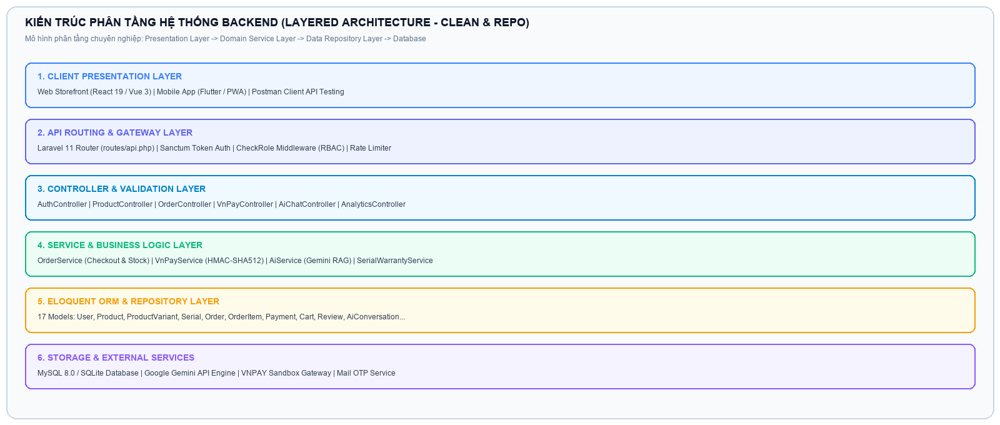
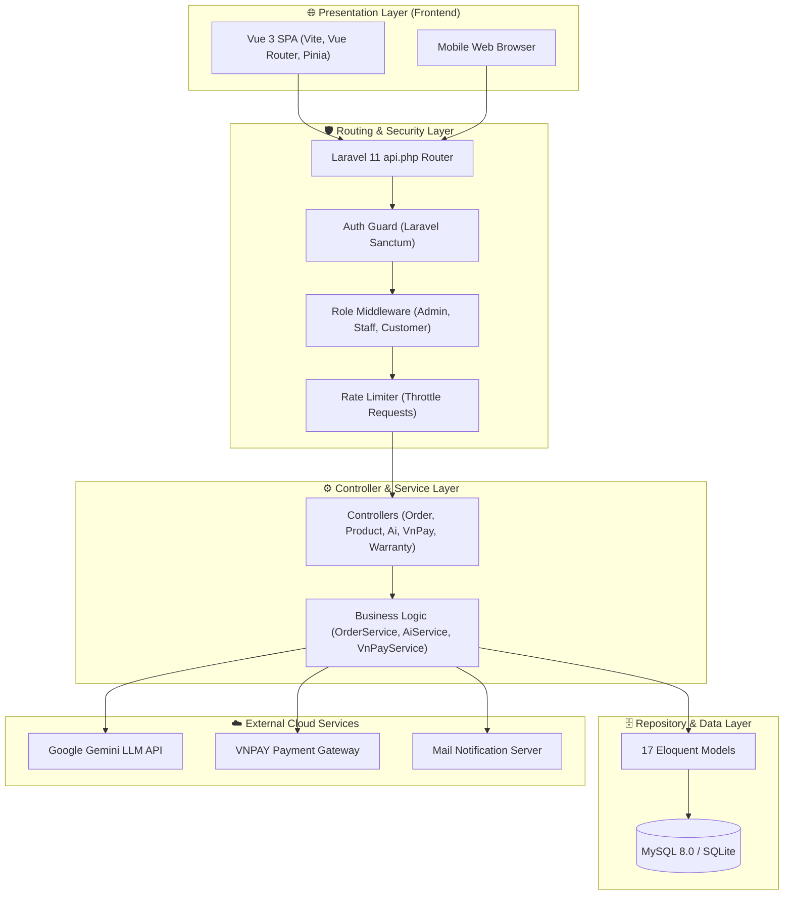
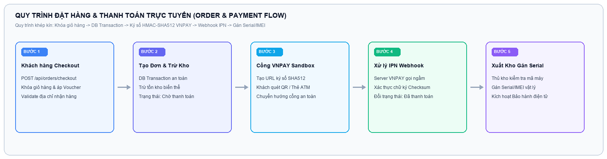
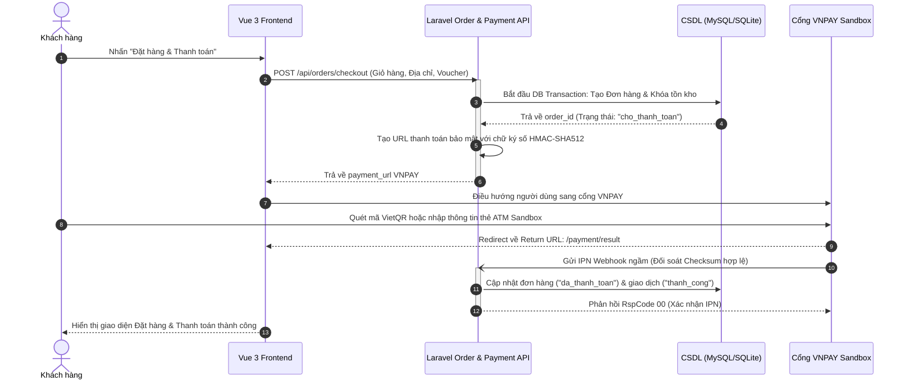
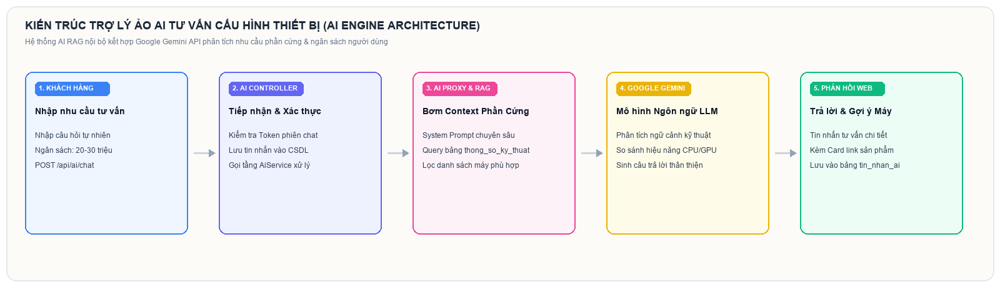
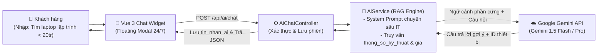
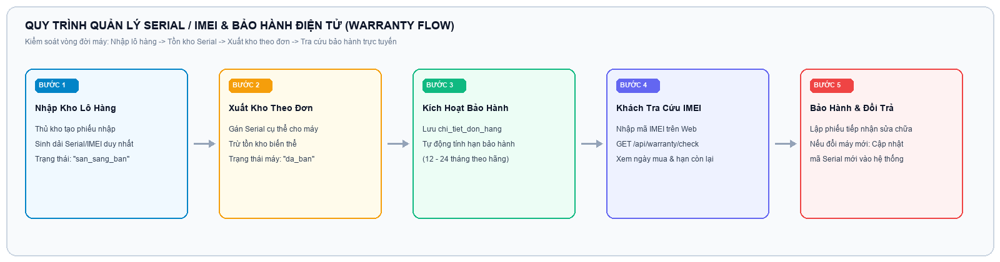

# ⚡ TECHMART AI - HỆ THỐNG BÁN THIẾT BỊ ĐIỆN TỬ THÔNG MINH
### *Đồ Án CDIO 4 (SE447 G) - Website E-Commerce Tích Hợp Trợ Lý Ảo AI Tư Vấn Cấu Hình & Cổng Thanh Toán VNPAY*

<p align="center">
  
  
  
  
  
  
  
  
</p>

---

## 📖 MỤC LỤC
1. [Giới thiệu Dự án](#-giới-thiệu-dự-án)
2. [Điểm nhấn Công nghệ Cốt lõi](#-điểm-nhấn-công-nghệ-cốt-lõi)
3. [Đội ngũ Phát triển & Phân công theo Tiến độ (Nhóm 2)](#-đội-ngũ-phát-triển--phân-công-theo-tiến-độ-dự-án-nhóm-2)
   - [3.1 Các hạng mục dự án đã hoàn thành (Done)](#31-các-hạng-mục-dự-án-đã-hoàn-thành-done)
   - [3.2 Bảng tổng hợp phân công tiếp theo](#32-bảng-tổng-hợp-phân-công-công-việc-tiếp-theo-to-do--in-progress)
   - [3.3 Chi tiết kế hoạch triển khai cho từng thành viên](#33-chi-tiết-kế-hoạch-triển-khai-cho-từng-thành-viên)
4. [Sơ đồ Kiến trúc & Quy trình Nghiệp vụ](#-sơ-đồ-kiến-trúc--quy-trình-nghiệp-vụ)
   - [4.1 Kiến trúc Phân tầng Hệ thống](#41-kiến-trúc-phân-tầng-hệ-thống)
   - [4.2 Quy trình Đặt hàng & Thanh toán VNPAY Sandbox](#42-quy-trình-đặt-hàng--thanh-toán-vnpay-sandbox)
   - [4.3 Kiến trúc Trợ lý ảo AI Tư vấn Cấu hình](#43-kiến-trúc-trợ-lý-ảo-ai-tư-vấn-cấu-hình-gemini-api)
   - [4.4 Quy trình Quản lý Serial/IMEI & Bảo hành Điện tử](#44-quy-trình-quản-lý-serialimei--bảo-hành-điện-tử)
5. [Cấu trúc Thư mục Toàn dự án (Monorepo)](#-cấu-trúc-thư-mục-toàn-dự-án-monorepo)
6. [Mô hình Cơ sở Dữ liệu (17 Bảng Chuẩn hóa)](#-mô-hình-cơ-sở-dữ-liệu-17-bảng-chuẩn-hóa)
7. [Danh mục API Endpoints Chính](#-danh-mục-api-endpoints-chính)
8. [Hướng dẫn Cài đặt & Khởi chạy (Fullstack Quick Start)](#-hướng-dẫn-cài-đặt--khởi-chạy-fullstack-quick-start)
   - [8.1 Khởi chạy Backend (Laravel 11)](#81-khởi-chạy-backend-laravel-11)
   - [8.2 Khởi chạy Frontend (Vue 3 + Vite)](#82-khởi-chạy-frontend-vue-3--vite)
   - [8.3 Tài khoản Quản trị & Trải nghiệm](#83-tài-khoản-quản-trị--trải-nghiệm)
9. [Công nghệ Sử dụng](#-công-nghệ-sử-dụng)

---

## 📌 GIỚI THIỆU DỰ ÁN

**TECHMART AI** là nền tảng thương mại điện tử chuyên biệt cho ngành thiết bị công nghệ (Laptop Gaming, Ultrabook, Smartphone, Linh kiện PC, Thiết bị ngoại vi), được phát triển trong khuôn khổ học phần **Đồ án CDIO 4 (SE447 G)**.

Hệ thống kết hợp mô hình Frontend hiện đại (**Vue 3 Composition API**) với Backend mạnh mẽ (**Laravel 11 RESTful API**), tích hợp công nghệ AI tạo sinh (**Google Gemini API**) và cổng thanh toán quốc gia (**VNPAY Sandbox**):

- 🛒 **Trải nghiệm Khách hàng (Storefront):** Tìm kiếm thông minh, lọc cấu hình theo thông số kỹ thuật chi tiết (CPU, RAM, GPU, ổ cứng), tư vấn trực tiếp 24/7 từ Trợ lý AI, thanh toán bảo mật với VNPAY QR/ATM/Thẻ tín dụng, và kiểm tra lịch sử bảo hành theo mã Serial/IMEI.
- ⚡ **Quản trị Bán hàng & Chăm sóc (Sales & CSKH):** Tiếp nhận đơn hàng theo thời gian thực, quản lý trạng thái xử lý đơn, phát hành Voucher chiết khấu và kiểm duyệt bình luận/đánh giá.
- 🏷️ **Quản lý Kho & Bảo hành Vật lý (Inventory & Warranty):** Cấp phát và theo dõi từng chiếc máy vật lý bằng dải mã Serial/IMEI riêng biệt, tự động kích hoạt bảo hành điện tử ngay sau khi xuất kho.
- 📊 **Phân tích Doanh nghiệp (Admin Dashboard):** Bảng thống kê doanh thu, tỷ lệ chuyển đổi, top sản phẩm bán chạy và quản lý phân quyền người dùng (RBAC).

---

## ✨ ĐIỂM NHẤN CÔNG NGHỆ CỐT LÕI

| Tính năng cốt lõi | Mô tả giải pháp kỹ thuật |
|:---|:---|
| 🤖 **Trợ lý AI Tư vấn Cấu hình** | Ứng dụng **Google Gemini API** kết hợp kỹ thuật **RAG (Retrieval-Augmented Generation)** nội bộ. AI đọc dữ liệu thông số kỹ thuật phần cứng thực tế trong CSDL để đưa ra khuyến nghị chính xác theo ngân sách và mục đích sử dụng (học tập, đồ họa, gaming, văn phòng). |
| 💳 **Thanh toán Trực tuyến VNPAY** | Tích hợp **VNPAY Sandbox** với thuật toán mã hóa chữ ký số chuẩn **HMAC-SHA512**. Xử lý đối soát giao dịch an toàn qua cơ chế **Webhook IPN (Instant Payment Notification)** chạy ngầm tự động. |
| 🏷️ **Quản lý Serial/IMEI Độc bản** | Quản lý vòng đời từng chiếc máy từ lúc nhập kho (`san_sang_ban`), xuất bán gán vào đơn hàng (`da_ban`) cho đến khi kích hoạt bảo hành điện tử và tiếp nhận sửa chữa/đổi trả (`bao_hanh`). |
| ⚡ **Kiến trúc Clean Architecture** | Tách biệt triệt để Controller, Service Layer và Eloquent Repository Pattern trên nền Laravel 11 giúp mã nguồn linh hoạt, dễ mở rộng và kiểm thử tự động với PHPUnit. |

---

## 👥 ĐỘI NGŨ PHÁT TRIỂN & PHÂN CÔNG THEO TIẾN ĐỘ DỰ ÁN (NHÓM 2)

> **Học phần:** Đồ án Công nghệ Thông tin / Kỹ thuật Phần mềm (SE447 G) - **Đại học Duy Tân**  
> **Giảng viên hướng dẫn:** ThS. Nguyễn Phúc Minh Tú

### 3.1 Các Hạng Mục Dự Án Đã Hoàn Thành (Done)
- [x] **Khởi tạo kiến trúc Fullstack Monorepo:** Cấu trúc phân tầng độc lập Laravel 11 RESTful API kết hợp Vue 3 (Composition API) & Vite.
- [x] **Cơ sở dữ liệu chuẩn hóa 17 bảng:** Hoàn tất hệ thống Migration, Model Eloquent ORM và bộ Database Seeders dữ liệu mẫu phong phú.
- [x] **Phân hệ Xác thực & Phân quyền (Auth & RBAC):** Đăng ký, đăng nhập, cấp phát Token Bearer và kiểm soát quyền hạn đa vai trò (Admin, Nhân viên, Khách hàng).
- [x] **Phân hệ Quản lý Tài khoản:** CRUD quản trị Nhân viên và Khách hàng, cơ chế khóa/mở trạng thái tài khoản.
- [x] **Phân hệ Danh mục, Thương hiệu & Sản phẩm:** CRUD quản trị Admin, hiển thị danh sách, phân trang, bộ lọc đa chiều (CPU, RAM, GPU, Giá) và xem chi tiết sản phẩm phía Client.
- [x] **Phân hệ Giỏ hàng (Shopping Cart):** Đầy đủ chức năng thêm vào giỏ, cập nhật số lượng, xóa từng món, làm trống giỏ hàng (kết nối hoàn chỉnh FE & BE).
- [x] **Phân hệ Quản lý Đơn hàng cơ bản:** Admin xem danh sách đơn hàng join khách hàng, cập nhật trạng thái đơn; Khách hàng xem lịch sử đơn hàng của mình.
- [x] **Phân hệ Tra cứu Bảo hành điện tử:** Tra cứu công khai thông tin thời hạn bảo hành qua mã Serial/IMEI thiết bị (`BaoHanhController`).
- [x] **Phân hệ Dashboard KPI Thống kê:** Báo cáo tổng đơn hàng, tổng doanh thu, tổng khách hàng, phân bổ trạng thái đơn và danh sách sản phẩm nổi bật.

---

### 3.2 Bảng Tổng Hợp Phân Công Công Việc Tiếp Theo (To-Do & In Progress)
*(Bao gồm đầy đủ phân công Backend và Giao diện Frontend/UI cho từng thành viên, loại bỏ toàn bộ các việc đã làm)*

| STT | Họ và Tên | MSSV | Vai trò Scrum | Nhiệm vụ Backend Trọng tâm | Nhiệm vụ Giao diện (Frontend / UI) |
|:---:|:---|:---:|:---|:---|:---|
| 1 | **Nguyễn Văn Kỳ** | `29211158606` | **Scrum Master / Tech Lead** | • Gemini AI Service (RAG Engine truy vấn phần cứng CSDL)<br>• Cổng VNPAY Checkout & Webhook IPN đối soát ngầm | • UI Quản lý & Giám sát Giao dịch VNPAY (Admin)<br>• UI Cấu hình AI Assistant & Test Prompt (Admin) |
| 2 | **Trần Đình Quang Dũng** | `29211140331` | **Database & Kho vận** | • API Quản trị kho Serial/IMEI theo lô<br>• Gán Serial đơn xuất kho & Xử lý bảo hành RMA | • UI Quản trị Kho Serial & Modal Nhập lô (Admin)<br>• UI Tra cứu Bảo hành điện tử công khai (Client) |
| 3 | **Lê Quốc Khánh** | `29211150801` | **Frontend Specialist** | • Hỗ trợ kết nối API Storefront & Tối ưu luồng State | • Widget Chat AI bong bóng nổi (Floating Chat Bubble)<br>• Màn hình Checkout Thanh toán & VNPAY Return |
| 4 | **Lê Nguyễn Công Giàu** | `29211158896` | **Products & Promotion** | • API Quản trị Voucher & Thuật toán giảm giá giỏ hàng<br>• API Đánh giá review sản phẩm & Kiểm duyệt review | • UI Quản trị Voucher & Khối áp Voucher mua hàng<br>• UI Đánh giá 1-5 sao & Duyệt bình luận Admin |
| 5 | **Nguyễn Hữu Thọ** | `29211150801` | **Orders & BI Analytics** | • Nghiệp vụ Hủy đơn hàng an toàn rollback kho tự động<br>• API Thống kê nâng cao theo mốc thời gian tùy chọn | • UI Quản lý vòng đời đơn hàng & Modal hủy đơn Client<br>• Dashboard BI biểu đồ trực quan & Xuất báo cáo Excel |

---

### 3.3 Chi Tiết Kế Hoạch Triển Khai Cho Từng Thành Viên (Backend & Giao Diện UI)

#### 3.3.1 NGUYỄN VĂN KỲ – Scrum Master / Tech Lead
> **Trách nhiệm:** Trực tiếp hiện thực hóa 2 tính năng công nghệ cốt lõi của đề tài: Trợ lý AI và Cổng thanh toán trực tuyến VNPAY (cả Backend và UI Quản trị tương ứng).

* **Nhiệm vụ Backend:**
  * **File:** `app/Services/AiService.php`, `app/Http/Controllers/ChatBotController.php`, `app/Services/VnPayService.php`, `app/Http/Controllers/DonHangController.php`, `app/Http/Controllers/ThanhToanController.php`, `config/services.php`, `config/vnpay.php`.
  * **Nghiệp vụ AI (RAG Engine):** Nhận prompt người dùng -> RAG truy vấn CSDL (`san_pham`, `thong_so_ky_thuat`) -> Đóng gói System Prompt IT gửi Gemini API -> Trả lời kèm gợi ý sản phẩm thực tế -> Lưu lịch sử vào `hoi_thoai_ai`, `tin_nhan_ai`.
  * **Nghiệp vụ Thanh toán VNPAY:** Hiện thực hóa logic hàm `checkout()` tạo đơn thật -> Gọi `VnPayService` băm SHA512 tạo URL thanh toán -> Xử lý Webhook IPN chạy ngầm giữa VNPAY Server và Backend cập nhật trạng thái `da_thanh_toan`.
  * **API Endpoints:**
    * `POST /api/client/chat-ai`, `GET /api/client/chat-ai/history/{sessionId}`, `POST /api/client/chat-ai/clear-session`
    * `POST /api/client/don-hang/checkout`, `GET /api/payment/vnpay/ipn`, `GET /api/payment/vnpay/return`
* **Nhiệm vụ Giao diện (Frontend / UI):**
  * **File:** Tích hợp tab Quản lý Giao dịch & AI vào `src/components/admin/index.vue`.
  * **UI 1: Bảng Quản trị & Đối soát Giao dịch VNPAY (Admin):** Hiển thị danh sách lịch sử giao dịch thanh toán trực tuyến, mã tham chiếu ngân hàng, mã phản hồi `vnp_ResponseCode`, số tiền, trạng thái đối soát IPN và thời gian thanh toán.
  * **UI 2: Bảng Điều khiển Cấu hình AI Assistant (Admin):** Cho phép Admin kiểm tra token usage, test thử prompt trực tiếp trong Dashboard và theo dõi thống kê số phiên chat AI phát sinh trong ngày.
* **Definition of Done (DoD):** AI phản hồi < 3s, đúng máy có thật trong kho; VNPAY Sandbox thanh toán thành công và cập nhật trạng thái đơn an toàn; UI Admin quản trị thanh toán trực quan.

---

#### 3.3.2 TRẦN ĐÌNH QUANG DŨNG – Backend Developer / Database & Kho vận
> **Trách nhiệm:** Hoàn thiện toàn diện phân hệ quản trị dải Serial/IMEI vật lý độc bản, quy trình gán máy xuất kho và giao diện tra cứu bảo hành điện tử.

* **Nhiệm vụ Backend:**
  * **File:** `app/Http/Controllers/SerialKhoController.php`, `app/Http/Controllers/BaoHanhController.php`, `app/Models/SerialSanPham.php`, `app/Models/BaoHanh.php`.
  * **Nghiệp vụ:** Nhập kho dải Serial/IMEI theo lô cho từng biến thể cấu hình (`san_sang_ban`); quét gán mã Serial cụ thể vào `chi_tiet_don_hang` khi đóng gói xuất bán (đổi trạng thái máy thành `da_ban` và kích hoạt ngày bảo hành); tiếp nhận phiếu bảo hành RMA (`dang_bao_hanh`).
  * **API Endpoints:**
    * `GET /api/admin/serials`, `POST /api/admin/serials/nhap-kho`
    * `POST /api/admin/don-hang/{id}/assign-serial`
    * `POST /api/client/bao-hanh/yeu-cau`, `PUT /api/admin/bao-hanh/{id}/cap-nhat-trang-thai`
* **Nhiệm vụ Giao diện (Frontend / UI):**
  * **File:** `src/components/admin/SerialManager.vue` (hoặc tab Serial trong Admin), `src/components/baohanh/TraCuuBaoHanh.vue`.
  * **UI 1: Màn hình Quản trị Kho Serial/IMEI (Admin):** Bảng hiển thị danh sách Serial/IMEI phân theo sản phẩm/biến thể, màu sắc thể hiện trạng thái (`san_sang_ban`, `da_ban`, `dang_bao_hanh`), Modal nhập nhanh danh sách Serial theo lô (dán text nhiều dòng hoặc upload file CSV).
  * **UI 2: Modal Gán Serial Đơn hàng (Admin):** Khi nhân viên kho bấm duyệt đơn đóng gói, hiển thị popup cho phép chọn/quét mã Serial vật lý tương ứng với từng sản phẩm trong đơn.
  * **UI 3: Trang Tra cứu Bảo hành điện tử Công khai (Client):** Giao diện tra cứu tại `/tra-cuu-bao-hanh` với thanh tìm kiếm Serial/IMEI nổi bật, thẻ Card hiển thị chi tiết hạn bảo hành điện tử sắc nét, timeline bảo hành và nút gửi yêu cầu hỗ trợ sửa chữa RMA.
* **Definition of Done (DoD):** Mỗi sản phẩm bán ra gắn đúng 1 Serial duy nhất; màn hình tra cứu bảo hành phản hồi tức thì với giao diện chuẩn nhận diện thương hiệu.

---

#### 3.3.3 LÊ QUỐC KHÁNH – Frontend Developer / Storefront Specialist
> **Trách nhiệm:** Xây dựng toàn bộ các thành phần giao diện trải nghiệm mua sắm hiện đại, tích hợp widget trợ lý AI nổi và hoàn thiện luồng thanh toán Checkout.

* **Nhiệm vụ Backend:**
  * Hỗ trợ tinh chỉnh format dữ liệu trả về từ API Storefront, tối ưu tải trang và cache phía Client.
* **Nhiệm vụ Giao diện (Frontend / UI):**
  * **File:** `src/components/chat/AiChatWidget.vue`, `src/components/checkout/index.vue`, `src/components/checkout/PaymentReturn.vue`, `src/router/index.js`.
  * **UI 1: Component Floating Chat Widget AI:**
    * Nút bong bóng chat nổi cố định góc phải màn hình với animation nhấp nháy thu hút khách hàng.
    * Khung cửa sổ chat hội thoại: hiển thị avatar AI, hiệu ứng gõ phím 3 chấm (typing indicator).
    * Hiển thị danh sách sản phẩm AI gợi ý dưới dạng danh sách thẻ Card (hình ảnh, tên cấu hình, giá niêm yết, nút "Xem chi tiết" và "Thêm nhanh vào giỏ").
  * **UI 2: Màn hình Đặt hàng & Thanh toán (Checkout Page):**
    * Form nhập thông tin người nhận (Họ tên, SĐT, Địa chỉ, Ghi chú giao hàng).
    * Bộ chọn phương thức thanh toán trực quan với logo nhận diện (VNPAY Sandbox QR/ATM hoặc COD).
    * Bảng tóm tắt đơn hàng (tạm tính, phí ship, giảm giá voucher, tổng thanh toán).
    * Nút "Xác nhận & Thanh toán" điều hướng người dùng sang cổng thanh toán VNPAY an toàn.
  * **UI 3: Màn hình Kết quả Thanh toán VNPAY (Payment Return View):**
    * Tiếp nhận các tham số phản hồi từ VNPAY (`vnp_ResponseCode`, `vnp_TransactionNo`, `vnp_Amount`).
    * Giao diện chúc mừng đặt hàng thành công (Icon xanh, mã đơn hàng, hướng dẫn nhận hàng) hoặc giao diện thông báo lỗi thanh toán kèm lý do và nút "Thanh toán lại".
* **Definition of Done (DoD):** Giao diện tương thích 100% trên cả Mobile và Desktop; luồng mua sắm liền mạch không giật lag.

---

#### 3.3.4 LÊ NGUYỄN CÔNG GIÀU – Fullstack Developer / Products & Promotion
> **Trách nhiệm:** Hiện thực hóa trọn vẹn cả Backend và Giao diện UI cho phân hệ Quản trị Voucher khuyến mãi và Hệ thống Đánh giá / Bình luận sản phẩm.

* **Nhiệm vụ Backend:**
  * **File:** `app/Http/Controllers/VoucherController.php`, `app/Http/Controllers/DanhGiaController.php`, `app/Models/Voucher.php`, `app/Models/Review.php`.
  * **Nghiệp vụ:** API CRUD Voucher (giảm theo % có trần hoặc tiền mặt cố định, hạn mức, ngày bắt đầu/kết thúc); API áp dụng voucher tính tiền chiết khấu; API gửi review 1-5 sao sau mua hàng và kiểm duyệt bình luận.
  * **API Endpoints:**
    * `GET /api/client/vouchers/active`, `POST /api/client/vouchers/apply`, `CRUD /api/admin/vouchers`
    * `POST /api/client/san-pham/{id}/danh-gia`, `POST /api/admin/danh-gia/change-status`
* **Nhiệm vụ Giao diện (Frontend / UI):**
  * **File:** Tab Quản lý Voucher & Đánh giá trong `src/components/admin/index.vue`, Component Review trong `src/components/trangchu/index.vue`.
  * **UI 1: Màn hình Quản trị Voucher (Admin):** Bảng danh sách voucher, trạng thái hoạt động/hết hạn, Modal thêm mới/chỉnh sửa mã giảm giá với các ô nhập trực quan.
  * **UI 2: Khối Áp dụng Voucher Mua sắm (Client):** Tích hợp vào Giỏ hàng và Trang Checkout: ô nhập mã coupon kèm nút "Áp dụng", hiển thị danh sách voucher gợi ý "Lưu mã", thông báo số tiền giảm màu xanh nổi bật ngay trên tổng đơn.
  * **UI 3: Khối Đánh giá & Bình luận Sản phẩm (Client):** Đặt tại chân trang Chi tiết sản phẩm: bộ lọc sao (1-5 sao), thanh tiến độ tỷ lệ đánh giá, form viết bình luận kèm chọn số sao và danh sách nhận xét của khách hàng đã mua có huy hiệu "Đã mua hàng tại TechMart".
  * **UI 4: Màn hình Kiểm duyệt Đánh giá (Admin):** Bảng danh sách bình luận mới, nút "Duyệt hiển thị" hoặc "Ẩn bình luận vi phạm".
* **Definition of Done (DoD):** Thuật toán tính giảm giá voucher chính xác trong mọi tình huống; giao diện nhập voucher và đánh giá sao trực quan, mượt mà.

---

#### 3.3.5 NGUYỄN HỮU THỌ – Backend Developer / Orders & BI Analytics
> **Trách nhiệm:** Hiện thực hóa quy trình nghiệp vụ hủy đơn hàng an toàn (Rollback kho) và nâng cấp Dashboard Báo cáo thống kê kinh doanh BI chuyên sâu cả Backend và Giao diện biểu đồ.

* **Nhiệm vụ Backend:**
  * **File:** `app/Http/Controllers/DonHangController.php` (bổ sung hàm `cancelOrder`), `app/Http/Controllers/ThongKeController.php` (mở rộng API thống kê nâng cao).
  * **Nghiệp vụ:** Logic kiểm tra điều kiện hủy đơn hợp lệ (chỉ được hủy khi đơn ở trạng thái `cho_xac_nhan` hoặc `da_xac_nhan`); kích hoạt Database Transaction tự động hoàn lại số lượng tồn kho; tính toán doanh thu theo mốc thời gian tùy chọn; xuất file báo cáo Excel/CSV.
  * **API Endpoints:**
    * `POST /api/client/don-hang/{id}/cancel`
    * `GET /api/admin/thong-ke/doanh-thu-nang-cao`
    * `GET /api/admin/thong-ke/xuat-excel`
* **Nhiệm vụ Giao diện (Frontend / UI):**
  * **File:** Tab Thống kê BI & Đơn hàng trong `src/components/admin/index.vue`, Modal Hủy đơn trong trang lịch sử đơn hàng Client.
  * **UI 1: Modal Yêu cầu Hủy đơn hàng (Client):** Trong trang lịch sử đơn hàng của khách, nếu đơn chưa đóng gói sẽ hiển thị nút "Hủy đơn hàng"; khi bấm hiện modal chọn lý do hủy (Đổi ý, Sai địa chỉ, Muốn đổi sản phẩm khác), xác nhận và hiển thị thông báo đã hủy kèm hoàn tiền/kho.
  * **UI 2: Nâng cấp Giao diện Quản lý Đơn hàng (Admin):** Bảng quản trị đơn hàng với bộ lọc trạng thái đa sắc màu (Badge màu), nút xem nhanh chi tiết sản phẩm trong đơn, timeline trạng thái đơn hàng.
  * **UI 3: Dashboard Báo cáo Kinh doanh BI Nâng cao (Admin):**
    * Bộ lọc thời gian linh hoạt (Hôm nay, 7 ngày qua, 30 ngày qua, Tháng này, hoặc tùy chọn `Từ ngày - Đến ngày`).
    * Biểu đồ đường (Line Chart) biểu diễn biến động doanh thu theo ngày/tháng.
    * Biểu đồ tròn (Donut Chart) tỷ lệ đơn hàng thành công vs đơn hàng bị hủy.
    * Nút bấm "Xuất Báo Cáo Excel" tải file bảng tính số liệu kinh doanh về máy chỉ với 1 cú click.
* **Definition of Done (DoD):** Hủy đơn an toàn không làm lệch kho; Dashboard hiển thị biểu đồ sắc nét, trích xuất file Excel chính xác phục vụ báo cáo hội đồng.

---

## 🏛️ SƠ ĐỒ KIẾN TRÚC & QUY TRÌNH NGHIỆP VỤ

### 4.1 Kiến trúc Phân tầng Hệ thống

<p align="center">
  
</p>



---

### 4.2 Quy trình Đặt hàng & Thanh toán VNPAY Sandbox

<p align="center">
  
</p>



---

### 4.3 Kiến trúc Trợ lý ảo AI Tư vấn Cấu hình (Gemini API)

<p align="center">
  
</p>



---

### 4.4 Quy trình Quản lý Serial/IMEI & Bảo hành Điện tử

<p align="center">
  
</p>

- 📥 **Giai đoạn Nhập kho:** Mỗi chiếc máy vật lý khi nhập kho được cấp một mã Serial/IMEI độc nhất với trạng thái `san_sang_ban`.
- 📦 **Giai đoạn Xuất bán:** Nhân viên đóng gói quét gán mã Serial/IMEI vào từng sản phẩm trong đơn hàng. Hệ thống tự động chuyển trạng thái máy thành `da_ban` và bắt đầu kích hoạt hạn bảo hành điện tử (12 - 24 tháng).
- 🔍 **Giai đoạn Tra cứu:** Khách hàng hoặc kỹ thuật viên có thể tra cứu hạn bảo hành trực tuyến tại `GET /api/warranty/check?serial={code}` mà không cần giữ phiếu bảo hành giấy.

---

## 📁 CẤU TRÚC THƯ MỤC TOÀN DỰ ÁN (MONOREPO)

```
DoAnCdio_4/
├── be_nhom2_qlbtbdt/             # BACKEND APPLICATION (Laravel 11)
│   ├── app/
│   │   ├── Http/Controllers/     # RESTful API Controllers
│   │   ├── Models/               # 17 Eloquent Models
│   │   └── Services/             # Business Logic (Order, VnPay, AiService)
│   ├── database/
│   │   ├── migrations/           # 17 Database Migrations
│   │   ├── seeders/              # Dữ liệu mẫu phong phú
│   │   └── database.sqlite       # Cơ sở dữ liệu mặc định
│   ├── routes/
│   │   └── api.php               # Danh mục toàn bộ API routes
│   ├── tests/                    # Unit & Feature Test cases
│   ├── composer.json             # PHP Dependencies
│   └── .env.example              # Mẫu cấu hình môi trường Backend
│
├── fe_nhom2_qlbtbdt/             # FRONTEND APPLICATION (Vue 3 + Vite)
│   ├── src/
│   │   ├── assets/               # CSS, Icons, Hình ảnh
│   │   ├── components/           # UI Components (Admin, Auth, Cart, Home)
│   │   ├── router/               # Vue Router cấu hình điều hướng
│   │   ├── utils/                # Axios API Client instance
│   │   ├── views/                # Các trang chính (Home, About, ...)
│   │   ├── App.vue               # Root Vue Component
│   │   └── main.js               # Entry Point
│   ├── package.json              # NPM Dependencies
│   └── vite.config.js            # Vite Configuration
│
├── docs/                         # TÀI LIỆU & HÌNH ẢNH DỰ ÁN
│   └── images/                   # Sơ đồ kiến trúc & luồng nghiệp vụ
├── .gitignore                    # Cấu hình Git Ignore toàn hệ thống
└── README.md                     # Tài liệu tổng quan dự án
```

---

## 🗄️ MÔ HÌNH CƠ SỞ DỮ LIỆU (17 BẢNG CHUẨN HÓA)

| STT | Tên bảng | Chức năng nghiệp vụ chính |
|:---:|:---|:---|
| 1 | `nguoi_dung` | Tài khoản người dùng, email, mật khẩu mã hóa Bcrypt, phân quyền (`admin`, `staff`, `customer`). |
| 2 | `dia_chi_nguoi_dung` | Sổ địa chỉ giao hàng của khách hàng (hỗ trợ nhiều địa chỉ, có gắn cờ mặc định). |
| 3 | `thuong_hieu` | Danh sách các hãng công nghệ lớn (Apple, Asus, Dell, HP, Lenovo, MSI, Samsung...). |
| 4 | `danh_muc` | Cây phân cấp danh mục thiết bị cha - con (Laptop, Điện thoại, Linh kiện, Phụ kiện). |
| 5 | `san_pham` | Thông tin gốc: Tên, mã sản phẩm, giá niêm yết, thời gian bảo hành và mô tả chi tiết. |
| 6 | `hinh_anh_san_pham` | Bộ sưu tập ảnh sản phẩm đa góc nhìn. |
| 7 | `thong_so_ky_thuat` | Cấu hình chi tiết: CPU, RAM, GPU, Ổ cứng, Màn hình, Pin, Trọng lượng & JSON mở rộng cho AI. |
| 8 | `bien_the_san_pham` | Tùy chọn cấu hình/màu sắc (RAM 16GB/32GB, SSD 512GB/1TB), SKU, giá bán lẻ và tồn kho. |
| 9 | `serial_san_pham` | Quản lý từng mã Serial/IMEI vật lý phục vụ bảo hành điện tử chính xác. |
| 10 | `ma_giam_gia` | Quản lý Voucher khuyến mãi theo % hoặc số tiền cố định, thời hạn sử dụng. |
| 11 | `don_hang` | Quản lý đơn hàng, thông tin người nhận, trạng thái vận chuyển và tổng thanh toán. |
| 12 | `chi_tiet_don_hang` | Danh sách từng sản phẩm/biến thể trong đơn hàng và giá bán thực tế. |
| 13 | `thanh_toan` | Nhật ký giao dịch: Mã thanh toán VNPAY, phương thức (COD/VNPAY) và trạng thái. |
| 14 | `gio_hang` | Giỏ hàng lưu trữ của khách hàng đã đăng nhập và khách vãng lai. |
| 15 | `danh_gia` | Đánh giá 1 - 5 sao và nhận xét phản hồi thực tế từ người mua. |
| 16 | `hoi_thoai_ai` | Quản lý các phiên trò chuyện tư vấn giữa khách hàng và Trợ lý AI. |
| 17 | `tin_nhan_ai` | Chi tiết câu hỏi của khách hàng và nội dung đề xuất kèm danh sách ID máy từ Gemini AI. |

---

## 🔌 DANH MỤC API ENDPOINTS CHÍNH

### 1. Xác thực & Tài khoản (`/api/auth`)
- `POST /api/auth/register` : Đăng ký tài khoản khách hàng mới.
- `POST /api/auth/login` : Đăng nhập hệ thống, cấp Sanctum Token.
- `POST /api/auth/logout` : Đăng xuất và thu hồi token hiện tại.
- `GET  /api/auth/me` : Lấy thông tin tài khoản và quyền hạn đang đăng nhập.

### 2. Sản phẩm & Mua sắm (`/api`)
- `GET  /api/categories` : Lấy danh mục sản phẩm phân cấp.
- `GET  /api/brands` : Lấy danh sách các thương hiệu.
- `GET  /api/products` : Lấy danh sách sản phẩm (có phân trang & sắp xếp).
- `GET  /api/products/filter` : Bộ lọc kỹ thuật đa tiêu chí (CPU, RAM, GPU, Hãng, Mức giá).
- `GET  /api/products/{slug}` : Chi tiết sản phẩm kèm cấu hình kỹ thuật & biến thể.
- `GET  /api/cart` : Xem giỏ hàng hiện tại.
- `POST /api/cart/add` : Thêm sản phẩm vào giỏ hàng (kiểm tra tồn kho tự động).
- `POST /api/vouchers/apply` : Áp dụng mã giảm giá.
- `POST /api/orders/checkout` : Tạo đơn hàng mới an toàn với DB Transaction.
- `POST /api/payment/vnpay/create-url` : Tạo URL thanh toán VNPAY mã hóa HMAC-SHA512.
- `GET  /api/payment/vnpay/ipn` : Webhook nhận thông báo giao dịch ngầm tự động từ VNPAY.
- `GET  /api/warranty/check?serial={code}` : Tra cứu bảo hành điện tử công khai theo Serial/IMEI.

### 3. Trợ lý AI Tư vấn Cấu hình (`/api/ai`)
- `POST /api/ai/chat` : Gửi yêu cầu tư vấn, AI phân tích nhu cầu và trả lời kèm danh sách sản phẩm.
- `GET  /api/ai/history` : Lấy lại lịch sử trò chuyện tư vấn của phiên người dùng.

### 4. Quản trị Phân hệ Admin (`/api/admin`)
- `GET  /api/admin/analytics/overview` : Tổng quan doanh thu, số đơn hàng và tăng trưởng.
- `CRUD /api/admin/products` : Quản lý thêm, sửa, xóa sản phẩm và biến thể.
- `GET  /api/admin/orders` : Danh sách đơn hàng toàn hệ thống & cập nhật trạng thái.
- `POST /api/admin/orders/{id}/assign-serial` : Gán mã Serial/IMEI vật lý trước khi xuất kho.

---

## 🚀 HƯỚNG DẪN CÀI ĐẶT & KHỞI CHẠY (FULLSTACK QUICK START)

### Yêu cầu tiên quyết:
- **PHP:** `>= 8.3` (Extension: `pdo_sqlite` hoặc `pdo_mysql`, `curl`, `mbstring`, `openssl`)
- **Composer:** `>= 2.5`
- **Node.js:** `>= 18.x` & **npm**

---

### 8.1 Khởi chạy Backend (Laravel 11)

```bash
# 1. Di chuyển vào thư mục backend
cd be_nhom2_qlbtbdt

# 2. Cài đặt các thư viện phụ thuộc PHP
composer install

# 3. Tạo file cấu hình môi trường
copy .env.example .env

# 4. Tạo Application Key
php artisan key:generate

# 5. Chạy Migration & Khởi tạo dữ liệu mẫu (17 Seeders)
php artisan migrate:fresh --seed

# 6. Khởi động Local API Server
php artisan serve
```
> API Server mặc định sẽ hoạt động tại: **`http://127.0.0.1:8000`**

---

### 8.2 Khởi chạy Frontend (Vue 3 + Vite)

Mở một cửa sổ Terminal mới:

```bash
# 1. Di chuyển vào thư mục frontend
cd fe_nhom2_qlbtbdt

# 2. Cài đặt các gói phụ thuộc NodeJS
npm install

# 3. Khởi chạy máy chủ phát triển
npm run dev
```
> Giao diện Web sẽ hoạt động tại: **`http://localhost:5173`**

---

### 8.3 Tài khoản Quản trị & Trải nghiệm

Sau khi chạy lệnh `php artisan migrate:fresh --seed`, hệ thống tự động khởi tạo các tài khoản demo:

| Phân quyền | Email đăng nhập | Mật khẩu mặc định | Ghi chú quyền hạn |
|:---|:---|:---:|:---|
| **Quản trị viên (Admin)** | `admin@techmart.vn` | `password` | Toàn quyền quản trị hệ thống, BI dashboard |
| **Nhân viên (Staff)** | `staff@techmart.vn` | `password` | Quản lý kho Serial/IMEI, duyệt đơn hàng |
| **Khách hàng (Customer)** | `customer@techmart.vn` | `password` | Mua sắm, chat AI, tra cứu bảo hành |

---

## 💻 CÔNG NGHỆ SỬ DỤNG

- **Frontend:** Vue 3 (Composition API), Vite, Vue Router, Pinia, Axios, Modern Responsive CSS.
- **Backend:** Laravel 11, PHP 8.3+, RESTful API, Laravel Sanctum, Form Requests, Service Layer.
- **Database:** SQLite (phát triển cục bộ) / MySQL 8.0 (triển khai production), 17 Migrations & Seeders.
- **Trí tuệ nhân tạo:** Google Gemini API (1.5 Flash / Pro) với System Prompting & Hardware Context RAG.
- **Thanh toán:** VNPAY Sandbox (Chữ ký HMAC-SHA512 & IPN Webhook).
- **Testing & Tools:** PHPUnit, Postman, Git / GitHub.

---

<p align="center">
  <b>© 2026 Nhóm 2 - Đồ Án CDIO 4 (SE447 G) - Đại Học Duy Tân</b><br/>
  <i>Đề tài: Hệ thống Website Quản Lý Bán Thiết Bị Điện Tử Tích Hợp AI Tư Vấn Khách Hàng</i>
</p>
