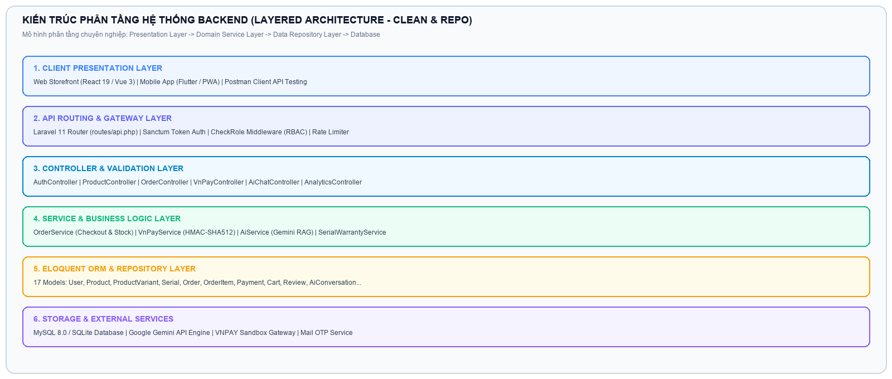
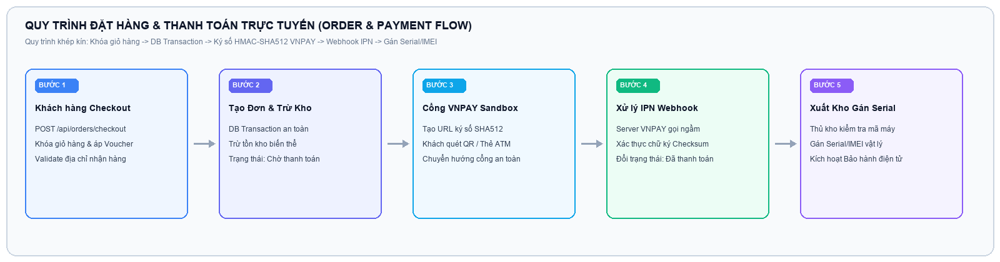
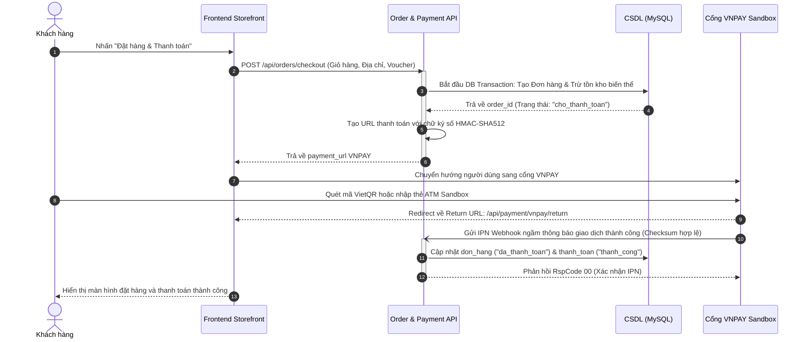
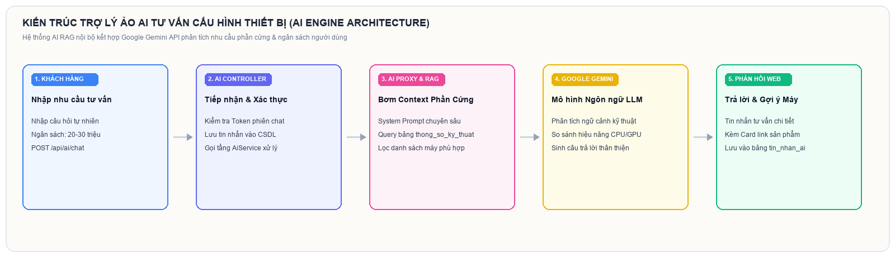
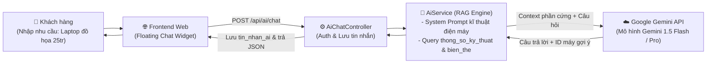
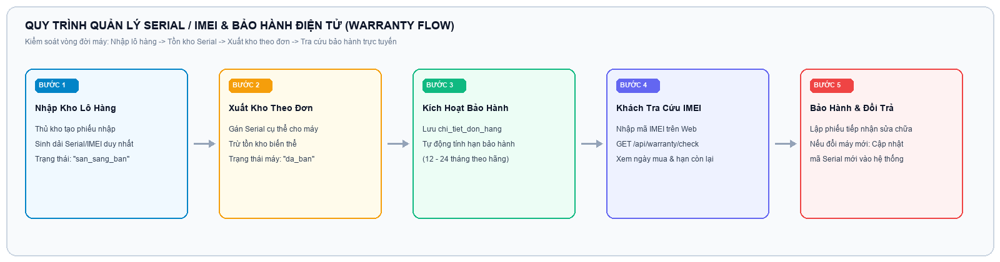

# ⚡ TECHMART AI - HỆ THỐNG BACKEND QUẢN LÝ BÁN THIẾT BỊ ĐIỆN TỬ
### *Website E-Commerce Điện Máy Tích Hợp Trợ Lý Ảo AI Tư Vấn Cấu Hình & Cổng Thanh Toán Trực Tuyến*

<p align="center">
  
  
  
  
  
  
</p>

---

## 📖 MỤC LỤC
1. [Giới thiệu Dự án](#-giới-thiệu-dự-án)
2. [Điểm nhấn Công nghệ Cốt lõi](#-điểm-nhấn-công-nghệ-cốt-lõi)
3. [Đội ngũ Phát triển & Phân công theo Tiến độ (Nhóm 2)](#-đội-ngũ-phát-triển--phân-công-theo-tiến-độ-dự-án-nhóm-2)
   - [3.1 Các hạng mục dự án đã hoàn thành (Done)](#31-các-hạng-mục-dự-án-đã-hoàn-thành-done)
   - [3.2 Bảng tổng hợp phân công tiếp theo](#32-bảng-tổng-hợp-phân-công-công-việc-tiếp-theo-to-do--in-progress)
   - [3.3 Chi tiết kế hoạch triển khai cho từng thành viên](#33-chi-tiết-kế-hoạch-triển-khai-cho-từng-thành-viên)
4. [Sơ đồ Kiến trúc Phân tầng Hệ thống (System Architecture)](#-sơ-đồ-kiến-trúc-phân-tầng-hệ-thống)
5. [Sơ đồ Các Quy trình Nghiệp vụ Cốt lõi (Workflow Diagrams)](#-sơ-đồ-các-quy-trình-nghiệp-vụ-cốt-lõi)
   - [5.1 Quy trình Đặt hàng & Thanh toán VNPAY (Checkout Flow)](#51-quy-trình-đặt-hàng--thanh-toán-vnpay-sandbox)
   - [5.2 Kiến trúc Trợ lý ảo AI tư vấn cấu hình (AI Engine Flow)](#52-kiến-trúc-trợ-lý-ảo-ai-tư-vấn-cấu-hình-gemini-api)
   - [5.3 Quy trình Quản lý Serial/IMEI & Bảo hành điện tử (Warranty Flow)](#53-quy-trình-quản-lý-kho-serialimei--bảo-hành-điện-tử)
6. [Cấu trúc Thư mục Mã nguồn Dự án (Directory Structure)](#-cấu-trúc-thư-mục-mã-nguồn-dự-án)
7. [Cơ sở Dữ liệu Chuẩn hóa (17 Bảng Tiếng Việt)](#-cơ-sở-dữ-liệu-chuẩn-hóa-17-bảng-tiếng-việt)
8. [Hệ thống Danh mục API (Endpoints Map)](#-hệ-thống-danh-mục-api-endpoints-map)
9. [Hướng dẫn Cài đặt & Khởi chạy (Quick Start)](#-hướng-dẫn-cài-đặt--khởi-chạy-quick-start)
10. [Tài liệu & Kế hoạch Dự án](#-tài-liệu--kế-hoạch-dự-án)

---

## 📌 GIỚI THIỆU DỰ ÁN
**TECHMART AI** là giải pháp phần mềm Back-end phục vụ hệ sinh thái thương mại điện tử chuyên ngành thiết bị công nghệ (Laptop Gaming, Ultrabook, Smartphone, Linh kiện PC, Phụ kiện số). Hệ thống giải quyết trọn vẹn chuỗi giá trị bán lẻ:
- **Khách hàng (Customer / Guest):** Tìm kiếm và lọc cấu hình đa chiều, so sánh thông số kỹ thuật, nhận tư vấn cấu hình tự động 24/7 từ Trợ lý AI, thanh toán bảo mật tức thời qua VNPAY và tra cứu lịch sử bảo hành theo mã Serial/IMEI.
- **Nhân viên Bán hàng & Chăm sóc (Sales / CSKH):** Quản lý trạng thái giỏ hàng, xác nhận đơn hàng, áp dụng Voucher khuyến mãi, xử lý đánh giá bình luận của khách.
- **Nhân viên Kho & Kỹ thuật (Warehouse & Warranty):** Quản lý nhập kho, dán và cấp phát dải mã Serial/IMEI vật lý cho từng máy, kích hoạt bảo hành điện tử và xử lý quy trình đổi trả hàng lỗi.
- **Quản trị viên (Admin):** Kiểm soát toàn quyền hệ thống, phân quyền vai trò (RBAC), quản lý nhân sự, xem dashboard phân tích doanh thu và báo cáo Business Intelligence (BI).

---

## ✨ ĐIỂM NHẤN CÔNG NGHỆ CỐT LÕI

| Tính năng cốt lõi | Mô tả giải pháp kỹ thuật |
|:---|:---|
| 🤖 **AI Smart Consultant** | Tích hợp **Google Gemini API** qua Service Proxy trung gian. Hệ thống xây dựng System Prompt chuyên sâu về phần cứng kết hợp RAG nội bộ để đọc dữ liệu thông số kỹ thuật (CPU, RAM, VGA, mức giá), tự động gợi ý thiết bị tối ưu theo ngân sách và mục đích sử dụng (học tập, đồ họa 3D, lập trình, gaming). |
| 💳 **VNPAY Gateway** | Tích hợp cổng thanh toán trực tuyến **VNPAY Sandbox** chuẩn HMAC-SHA512. Xử lý đồng bộ dữ liệu giao dịch qua Webhook IPN chạy ngầm, đảm bảo an toàn tuyệt đối, chống gian lận và tự động hóa cập nhật trạng thái đơn hàng. |
| 🏷️ **Quản lý Serial / IMEI** | Mỗi thiết bị xuất bán đều được gán mã định danh phần cứng (Serial/IMEI) duy nhất. Cho phép người dùng tra cứu hạn bảo hành trực tuyến và giúp thủ kho kiểm soát chính xác tồn kho theo từng máy vật lý. |
| ⚡ **Clean Architecture** | Áp dụng mô hình **Service - Repository Pattern** trên nền Laravel 11 giúp tách biệt rành mạch giữa Controller, Business Logic và Database Layer, dễ dàng mở rộng và bảo trì. |

---

## 👥 ĐỘI NGŨ PHÁT TRIỂN & PHÂN CÔNG THEO TIẾN ĐỘ DỰ ÁN (NHÓM 2)

> **Học phần:** Đồ án Công nghệ Thông tin / Kỹ thuật Phần mềm (SE447 G) - Đại học Duy Tân  
> **Giảng viên hướng dẫn:** ThS. Nguyễn Phúc Minh Tú

### 3.1 Các Hạng Mục Dự Án Đã Hoàn Thành (Done)
- [x] **Khởi tạo kiến trúc Backend Laravel 11:** Thiết lập môi trường, cấu hình CORS, Timezone, chuẩn hóa JSON Response và phân tầng Controller.
- [x] **Cơ sở dữ liệu chuẩn hóa 17 bảng:** Hoàn tất toàn bộ 17 Migrations, Eloquent Models, Relationships và bộ Data Seeders dữ liệu mẫu đầy đủ.
- [x] **Xác thực & Quản lý Tài khoản (Auth):** API Đăng ký, Đăng nhập Admin/Client, kiểm tra Token Sanctum, phân quyền người dùng (Admin, Nhân viên, Khách hàng).
- [x] **Quản lý Nhân sự & Khách hàng:** API CRUD Nhân viên, Khách hàng, cơ chế đổi trạng thái hoạt động/khóa tài khoản.
- [x] **Quản lý Danh mục, Thương hiệu & Sản phẩm:** Toàn bộ API CRUD Admin, API lấy danh sách, bộ lọc đa chiều (CPU, RAM, GPU, Giá), chi tiết sản phẩm và so sánh cấu hình.
- [x] **Module Giỏ hàng (Shopping Cart):** API Thêm vào giỏ, cập nhật số lượng, xóa từng sản phẩm và làm trống giỏ hàng.
- [x] **Quản lý Đơn hàng cơ bản:** Admin xem danh sách đơn hàng join thông tin khách hàng, cập nhật trạng thái đơn; Client xem lịch sử mua sắm.
- [x] **Tra cứu Bảo hành điện tử:** API tra cứu thông tin bảo hành công khai bằng số Serial hoặc mã IMEI (`BaoHanhController`).
- [x] **Dashboard Thống kê KPI:** API tổng hợp số liệu tổng đơn, tổng doanh thu, tổng khách, trạng thái đơn và top 5 sản phẩm nổi bật (`ThongKeController`).

---

### 3.2 Bảng Tổng Hợp Phân Công Công Việc Tiếp Theo (To-Do & In Progress)
*(Bao gồm đầy đủ phân công Backend và Giao diện Frontend/UI cho từng thành viên, loại bỏ toàn bộ các việc đã làm)*

| STT | Họ và Tên | MSSV | Vai trò Scrum | Nhiệm vụ Backend Trọng tâm | Nhiệm vụ Giao diện (Frontend / UI) |
|:---:|:---|:---:|:---|:---|:---|
| 1 | **Nguyễn Văn Kỳ** | `29211158606` | **Scrum Master / Tech Lead** | • Gemini AI Service (RAG Engine truy vấn phần cứng CSDL)<br>• Cổng VNPAY Checkout & Webhook IPN đối soát ngầm | • UI Quản lý & Giám sát Giao dịch VNPAY (Admin)<br>• UI Cấu hình AI Assistant & Test Prompt (Admin) |
| 2 | **Trần Đình Quang Dũng** | `29211140331` | **Database & Kho vận** | • API Quản trị kho Serial/IMEI theo lô<br>• Gán Serial đơn xuất kho & Xử lý bảo hành RMA | • UI Quản trị Kho Serial & Modal Nhập lô (Admin)<br>• UI Tra cứu Bảo hành điện tử công khai (Client) |
| 3 | **Lê Quốc Khánh** | `29211150801` | **Frontend Specialist** | • Hỗ trợ kết nối API Storefront & Tối ưu luồng State | • Widget Chat AI bong bóng nổi (Floating Chat Bubble)<br>• Màn hình Checkout Thanh toán & VNPAY Return |
| 4 | **Lê Nguyễn Công Giàu** | `29211158896` | **Products & Promotion** | • API Quản trị Voucher & Thuật toán giảm giá giỏ hàng<br>• API Đánh giá review sản phẩm & Kiểm duyệt review | • UI Quản trị Voucher & Khối áp Voucher mua hàng<br>• UI Đánh giá 1-5 sao & Duyệt bình luận Admin |
| 5 | **Nguyễn Hữu Thọ** | `29211150801` | **Orders & BI Analytics** | • Nghiệp vụ Hủy đơn hàng an toàn rollback kho tự động<br>• API Thống kê nâng cao theo mốc thời gian tùy chọn | • UI Quản lý vòng đời đơn hàng & Modal hủy đơn Client<br>• Dashboard BI biểu đồ trực quan & Xuất báo cáo Excel |

---

### 3.3 Chi Tiết Kế Hoạch Triển Khai Cho Từng Thành Viên (Backend & Giao Diện UI)

#### 3.3.1 NGUYỄN VĂN KỲ – Scrum Master / Tech Lead
> **Trách nhiệm:** Trực tiếp hiện thực hóa 2 tính năng công nghệ cốt lõi của đề tài: Trợ lý AI và Cổng thanh toán trực tuyến VNPAY (cả Backend và UI Quản trị tương ứng).

* **Nhiệm vụ Backend:**
  * **File:** `app/Services/AiService.php`, `app/Http/Controllers/ChatBotController.php`, `app/Services/VnPayService.php`, `app/Http/Controllers/DonHangController.php`, `app/Http/Controllers/ThanhToanController.php`, `config/services.php`, `config/vnpay.php`.
  * **Nghiệp vụ AI (RAG Engine):** Nhận prompt người dùng -> RAG truy vấn CSDL (`san_pham`, `thong_so_ky_thuat`) -> Đóng gói System Prompt IT gửi Gemini API -> Trả lời kèm gợi ý sản phẩm thực tế -> Lưu lịch sử vào `hoi_thoai_ai`, `tin_nhan_ai`.
  * **Nghiệp vụ Thanh toán VNPAY:** Hiện thực hóa logic hàm `checkout()` tạo đơn thật -> Gọi `VnPayService` băm SHA512 tạo URL thanh toán -> Xử lý Webhook IPN chạy ngầm giữa VNPAY Server và Backend cập nhật trạng thái `da_thanh_toan`.
  * **API Endpoints:**
    * `POST /api/client/chat-ai`, `GET /api/client/chat-ai/history/{sessionId}`, `POST /api/client/chat-ai/clear-session`
    * `POST /api/client/don-hang/checkout`, `GET /api/payment/vnpay/ipn`, `GET /api/payment/vnpay/return`
* **Nhiệm vụ Giao diện (Frontend / UI):**
  * **File:** Tích hợp tab Quản lý Giao dịch & AI vào `src/components/admin/index.vue`.
  * **UI 1: Bảng Quản trị & Đối soát Giao dịch VNPAY (Admin):** Hiển thị danh sách lịch sử giao dịch thanh toán trực tuyến, mã tham chiếu ngân hàng, mã phản hồi `vnp_ResponseCode`, số tiền, trạng thái đối soát IPN và thời gian thanh toán.
  * **UI 2: Bảng Điều khiển Cấu hình AI Assistant (Admin):** Cho phép Admin kiểm tra token usage, test thử prompt trực tiếp trong Dashboard và theo dõi thống kê số phiên chat AI phát sinh trong ngày.
* **Definition of Done (DoD):** AI phản hồi < 3s, đúng máy có thật trong kho; VNPAY Sandbox thanh toán thành công và cập nhật trạng thái đơn an toàn; UI Admin quản trị thanh toán trực quan.

---

#### 3.3.2 TRẦN ĐÌNH QUANG DŨNG – Backend Developer / Database & Kho vận
> **Trách nhiệm:** Hoàn thiện toàn diện phân hệ quản trị dải Serial/IMEI vật lý độc bản, quy trình gán máy xuất kho và giao diện tra cứu bảo hành điện tử.

* **Nhiệm vụ Backend:**
  * **File:** `app/Http/Controllers/SerialKhoController.php`, `app/Http/Controllers/BaoHanhController.php`, `app/Models/SerialSanPham.php`, `app/Models/BaoHanh.php`.
  * **Nghiệp vụ:** Nhập kho dải Serial/IMEI theo lô cho từng biến thể cấu hình (`san_sang_ban`); quét gán mã Serial cụ thể vào `chi_tiet_don_hang` khi đóng gói xuất bán (đổi trạng thái máy thành `da_ban` và kích hoạt ngày bảo hành); tiếp nhận phiếu bảo hành RMA (`dang_bao_hanh`).
  * **API Endpoints:**
    * `GET /api/admin/serials`, `POST /api/admin/serials/nhap-kho`
    * `POST /api/admin/don-hang/{id}/assign-serial`
    * `POST /api/client/bao-hanh/yeu-cau`, `PUT /api/admin/bao-hanh/{id}/cap-nhat-trang-thai`
* **Nhiệm vụ Giao diện (Frontend / UI):**
  * **File:** `src/components/admin/SerialManager.vue` (hoặc tab Serial trong Admin), `src/components/baohanh/TraCuuBaoHanh.vue`.
  * **UI 1: Màn hình Quản trị Kho Serial/IMEI (Admin):** Bảng hiển thị danh sách Serial/IMEI phân theo sản phẩm/biến thể, màu sắc thể hiện trạng thái (`san_sang_ban`, `da_ban`, `dang_bao_hanh`), Modal nhập nhanh danh sách Serial theo lô (dán text nhiều dòng hoặc upload file CSV).
  * **UI 2: Modal Gán Serial Đơn hàng (Admin):** Khi nhân viên kho bấm duyệt đơn đóng gói, hiển thị popup cho phép chọn/quét mã Serial vật lý tương ứng với từng sản phẩm trong đơn.
  * **UI 3: Trang Tra cứu Bảo hành điện tử Công khai (Client):** Giao diện tra cứu tại `/tra-cuu-bao-hanh` với thanh tìm kiếm Serial/IMEI nổi bật, thẻ Card hiển thị chi tiết hạn bảo hành điện tử sắc nét, timeline bảo hành và nút gửi yêu cầu hỗ trợ sửa chữa RMA.
* **Definition of Done (DoD):** Mỗi sản phẩm bán ra gắn đúng 1 Serial duy nhất; màn hình tra cứu bảo hành phản hồi tức thì với giao diện chuẩn nhận diện thương hiệu.

---

#### 3.3.3 LÊ QUỐC KHÁNH – Frontend Developer / Storefront Specialist
> **Trách nhiệm:** Xây dựng toàn bộ các thành phần giao diện trải nghiệm mua sắm hiện đại, tích hợp widget trợ lý AI nổi và hoàn thiện luồng thanh toán Checkout.

* **Nhiệm vụ Backend:**
  * Hỗ trợ tinh chỉnh format dữ liệu trả về từ API Storefront, tối ưu tải trang và cache phía Client.
* **Nhiệm vụ Giao diện (Frontend / UI):**
  * **File:** `src/components/chat/AiChatWidget.vue`, `src/components/checkout/index.vue`, `src/components/checkout/PaymentReturn.vue`, `src/router/index.js`.
  * **UI 1: Component Floating Chat Widget AI:**
    * Nút bong bóng chat nổi cố định góc phải màn hình với animation nhấp nháy thu hút khách hàng.
    * Khung cửa sổ chat hội thoại: hiển thị avatar AI, hiệu ứng gõ phím 3 chấm (typing indicator).
    * Hiển thị danh sách sản phẩm AI gợi ý dưới dạng danh sách thẻ Card (hình ảnh, tên cấu hình, giá niêm yết, nút "Xem chi tiết" và "Thêm nhanh vào giỏ").
  * **UI 2: Màn hình Đặt hàng & Thanh toán (Checkout Page):**
    * Form nhập thông tin người nhận (Họ tên, SĐT, Địa chỉ, Ghi chú giao hàng).
    * Bộ chọn phương thức thanh toán trực quan với logo nhận diện (VNPAY Sandbox QR/ATM hoặc COD).
    * Bảng tóm tắt đơn hàng (tạm tính, phí ship, giảm giá voucher, tổng thanh toán).
    * Nút "Xác nhận & Thanh toán" điều hướng người dùng sang cổng thanh toán VNPAY an toàn.
  * **UI 3: Màn hình Kết quả Thanh toán VNPAY (Payment Return View):**
    * Tiếp nhận các tham số phản hồi từ VNPAY (`vnp_ResponseCode`, `vnp_TransactionNo`, `vnp_Amount`).
    * Giao diện chúc mừng đặt hàng thành công (Icon xanh, mã đơn hàng, hướng dẫn nhận hàng) hoặc giao diện thông báo lỗi thanh toán kèm lý do và nút "Thanh toán lại".
* **Definition of Done (DoD):** Giao diện tương thích 100% trên cả Mobile và Desktop; luồng mua sắm liền mạch không giật lag.

---

#### 3.3.4 LÊ NGUYỄN CÔNG GIÀU – Fullstack Developer / Products & Promotion
> **Trách nhiệm:** Hiện thực hóa trọn vẹn cả Backend và Giao diện UI cho phân hệ Quản trị Voucher khuyến mãi và Hệ thống Đánh giá / Bình luận sản phẩm.

* **Nhiệm vụ Backend:**
  * **File:** `app/Http/Controllers/VoucherController.php`, `app/Http/Controllers/DanhGiaController.php`, `app/Models/Voucher.php`, `app/Models/Review.php`.
  * **Nghiệp vụ:** API CRUD Voucher (giảm theo % có trần hoặc tiền mặt cố định, hạn mức, ngày bắt đầu/kết thúc); API áp dụng voucher tính tiền chiết khấu; API gửi review 1-5 sao sau mua hàng và kiểm duyệt bình luận.
  * **API Endpoints:**
    * `GET /api/client/vouchers/active`, `POST /api/client/vouchers/apply`, `CRUD /api/admin/vouchers`
    * `POST /api/client/san-pham/{id}/danh-gia`, `POST /api/admin/danh-gia/change-status`
* **Nhiệm vụ Giao diện (Frontend / UI):**
  * **File:** Tab Quản lý Voucher & Đánh giá trong `src/components/admin/index.vue`, Component Review trong `src/components/trangchu/index.vue`.
  * **UI 1: Màn hình Quản trị Voucher (Admin):** Bảng danh sách voucher, trạng thái hoạt động/hết hạn, Modal thêm mới/chỉnh sửa mã giảm giá với các ô nhập trực quan.
  * **UI 2: Khối Áp dụng Voucher Mua sắm (Client):** Tích hợp vào Giỏ hàng và Trang Checkout: ô nhập mã coupon kèm nút "Áp dụng", hiển thị danh sách voucher gợi ý "Lưu mã", thông báo số tiền giảm màu xanh nổi bật ngay trên tổng đơn.
  * **UI 3: Khối Đánh giá & Bình luận Sản phẩm (Client):** Đặt tại chân trang Chi tiết sản phẩm: bộ lọc sao (1-5 sao), thanh tiến độ tỷ lệ đánh giá, form viết bình luận kèm chọn số sao và danh sách nhận xét của khách hàng đã mua có huy hiệu "Đã mua hàng tại TechMart".
  * **UI 4: Màn hình Kiểm duyệt Đánh giá (Admin):** Bảng danh sách bình luận mới, nút "Duyệt hiển thị" hoặc "Ẩn bình luận vi phạm".
* **Definition of Done (DoD):** Thuật toán tính giảm giá voucher chính xác trong mọi tình huống; giao diện nhập voucher và đánh giá sao trực quan, mượt mà.

---

#### 3.3.5 NGUYỄN HỮU THỌ – Backend Developer / Orders & BI Analytics
> **Trách nhiệm:** Hiện thực hóa quy trình nghiệp vụ hủy đơn hàng an toàn (Rollback kho) và nâng cấp Dashboard Báo cáo thống kê kinh doanh BI chuyên sâu cả Backend và Giao diện biểu đồ.

* **Nhiệm vụ Backend:**
  * **File:** `app/Http/Controllers/DonHangController.php` (bổ sung hàm `cancelOrder`), `app/Http/Controllers/ThongKeController.php` (mở rộng API thống kê nâng cao).
  * **Nghiệp vụ:** Logic kiểm tra điều kiện hủy đơn hợp lệ (chỉ được hủy khi đơn ở trạng thái `cho_xac_nhan` hoặc `da_xac_nhan`); kích hoạt Database Transaction tự động hoàn lại số lượng tồn kho; tính toán doanh thu theo mốc thời gian tùy chọn; xuất file báo cáo Excel/CSV.
  * **API Endpoints:**
    * `POST /api/client/don-hang/{id}/cancel`
    * `GET /api/admin/thong-ke/doanh-thu-nang-cao`
    * `GET /api/admin/thong-ke/xuat-excel`
* **Nhiệm vụ Giao diện (Frontend / UI):**
  * **File:** Tab Thống kê BI & Đơn hàng trong `src/components/admin/index.vue`, Modal Hủy đơn trong trang lịch sử đơn hàng Client.
  * **UI 1: Modal Yêu cầu Hủy đơn hàng (Client):** Trong trang lịch sử đơn hàng của khách, nếu đơn chưa đóng gói sẽ hiển thị nút "Hủy đơn hàng"; khi bấm hiện modal chọn lý do hủy (Đổi ý, Sai địa chỉ, Muốn đổi sản phẩm khác), xác nhận và hiển thị thông báo đã hủy kèm hoàn tiền/kho.
  * **UI 2: Nâng cấp Giao diện Quản lý Đơn hàng (Admin):** Bảng quản trị đơn hàng với bộ lọc trạng thái đa sắc màu (Badge màu), nút xem nhanh chi tiết sản phẩm trong đơn, timeline trạng thái đơn hàng.
  * **UI 3: Dashboard Báo cáo Kinh doanh BI Nâng cao (Admin):**
    * Bộ lọc thời gian linh hoạt (Hôm nay, 7 ngày qua, 30 ngày qua, Tháng này, hoặc tùy chọn `Từ ngày - Đến ngày`).
    * Biểu đồ đường (Line Chart) biểu diễn biến động doanh thu theo ngày/tháng.
    * Biểu đồ tròn (Donut Chart) tỷ lệ đơn hàng thành công vs đơn hàng bị hủy.
    * Nút bấm "Xuất Báo Cáo Excel" tải file bảng tính số liệu kinh doanh về máy chỉ với 1 cú click.
* **Definition of Done (DoD):** Hủy đơn an toàn không làm lệch kho; Dashboard hiển thị biểu đồ sắc nét, trích xuất file Excel chính xác phục vụ báo cáo hội đồng.

---

## 🏛️ SƠ ĐỒ KIẾN TRÚC PHÂN TẦNG HỆ THỐNG

<p align="center">
  
</p>

### Chi tiết các tầng kiến trúc:
1. **Client Presentation Layer:** Ứng dụng Web Storefront (React 19 / Vue 3), Mobile Web PWA và Postman Client kết nối thông qua giao thức bảo mật HTTPS/JSON RESTful API.
2. **API Routing & Security Layer:** Router Laravel 11 (`routes/api.php`), tầng xác thực Token Bearer (Laravel Sanctum), Middleware kiểm tra phân quyền người dùng (`CheckRole:admin,staff,customer`) và Rate Limiting chống DDoS / Spam API.
3. **Controller & Validation Layer:** Tiếp nhận HTTP Requests, chuẩn hóa dữ liệu thông qua Form Requests, điều hướng logic và trả về JSON chuẩn theo RESTful.
4. **Service & Business Logic Layer:** Xử lý nghiệp vụ chuyên sâu độc lập (`OrderService`, `VnPayService`, `AiService`, `SerialWarrantyService`).
5. **Eloquent ORM & Repository Layer:** Đóng gói truy vấn với 17 Models Eloquent, quản lý quan hệ bảng phức tạp và xử lý Database Transaction an toàn.
6. **Storage & External Services:** Hệ CSDL MySQL 8.0 / SQLite, Google Gemini LLM API, Cổng VNPAY Sandbox và Dịch vụ gửi Mail thông báo OTP.

---

## 🔄 SƠ ĐỒ CÁC QUY TRÌNH NGHIỆP VỤ CỐT LÕI

### 5.1 Quy trình Đặt hàng & Thanh toán VNPAY Sandbox

<p align="center">
  
</p>



---

### 5.2 Kiến trúc Trợ lý ảo AI Tư vấn Cấu hình (Gemini API)

<p align="center">
  
</p>



---

### 5.3 Quy trình Quản lý Kho Serial/IMEI & Bảo hành Điện tử

<p align="center">
  
</p>

- **Giai đoạn Nhập kho:** Thủ kho nhập lô hàng máy mới, hệ thống tự động sinh dải Serial/IMEI duy nhất cho từng máy với trạng thái `san_sang_ban`.
- **Giai đoạn Xuất bán:** Khi đơn hàng hoàn tất đóng gói, nhân viên quét gán mã Serial/IMEI cụ thể vào `chi_tiet_don_hang`. Trạng thái máy chuyển thành `da_ban` và thời gian bảo hành bắt đầu được tính tự động (12 - 24 tháng theo chính sách).
- **Giai đoạn Tra cứu & Bảo hành:** Khách hàng hoặc kỹ thuật viên chỉ cần nhập mã Serial/IMEI trên website (`GET /api/warranty/check`) là có thể kiểm tra chính xác ngày xuất kho, tên khách hàng và thời hạn bảo hành còn lại để làm thủ tục sửa chữa/đổi trả.

---

## 📁 CẤU TRÚC THƯ MỤC MÃ NGUỒN DỰ ÁN

```
NHOM1_BE_QLBTBDT/
├── app/
│   ├── Http/
│   │   ├── Controllers/             # Tầng điều khiển tiếp nhận & phản hồi HTTP API
│   │   │   ├── AuthController.php            # Đăng ký, Đăng nhập, JWT Token, Đăng xuất
│   │   │   ├── ProductController.php         # Danh sách, Chi tiết, Lọc cấu hình sản phẩm
│   │   │   ├── CategoryController.php        # Quản lý danh mục thiết bị cha - con
│   │   │   ├── BrandController.php           # Quản lý thương hiệu công nghệ
│   │   │   ├── CartController.php            # Thêm, sửa, xóa, tính tổng tiền giỏ hàng
│   │   │   ├── VoucherController.php         # Quản lý & áp dụng mã giảm giá khuyến mãi
│   │   │   ├── OrderController.php           # Tạo đơn hàng, Lịch sử mua & Hủy đơn
│   │   │   ├── VnPayController.php           # Khởi tạo URL, Xử lý Return URL & IPN Webhook
│   │   │   ├── ProductSerialController.php   # Quản lý dải Serial/IMEI & Tra cứu bảo hành
│   │   │   ├── AiChatController.php          # Tiếp nhận chat hội thoại tư vấn AI
│   │   │   └── AnalyticsController.php       # Báo cáo thống kê doanh số & BI Dashboard
│   │   └── Middleware/              # Kiểm tra xác thực Sanctum, phân quyền Role (RBAC)
│   ├── Models/                      # Tầng dữ liệu Eloquent ORM (17 Bảng quan hệ)
│   │   ├── User.php                 # Tài khoản (Admin, Staff, Customer)
│   │   ├── Product.php              # Sản phẩm cốt lõi
│   │   ├── ProductVariant.php       # Biến thể cấu hình RAM/SSD, Màu sắc, SKU
│   │   ├── ProductSpecification.php # Thông số kỹ thuật CPU, GPU, Màn hình, JSON
│   │   ├── ProductSerial.php        # Mã Serial/IMEI từng máy phục vụ bảo hành
│   │   ├── Order.php                # Đơn đặt hàng
│   │   ├── OrderItem.php            # Chi tiết từng mặt hàng trong đơn
│   │   ├── Payment.php              # Lịch sử giao dịch thanh toán
│   │   ├── Cart.php                 # Giỏ hàng người dùng
│   │   ├── Category.php             # Danh mục sản phẩm
│   │   ├── Brand.php                # Thương hiệu phần cứng
│   │   ├── Voucher.php              # Mã giảm giá
│   │   ├── Review.php               # Đánh giá 1-5 sao từ khách
│   │   ├── AiConversation.php       # Phiên hội thoại với Trợ lý ảo AI
│   │   └── AiMessage.php            # Chi tiết tin nhắn & gợi ý sản phẩm của AI
│   └── Services/                    # Tầng Business Logic chuyên sâu
│       ├── OrderService.php         # Nghiệp vụ tạo đơn hàng & khóa tồn kho
│       ├── VnPayService.php         # Thuật toán ký số HMAC-SHA512 & đối soát IPN
│       └── AiService.php            # Kết nối Google Gemini API & RAG Context
├── database/
│   ├── migrations/                  # 17 Migration scripts định nghĩa lược đồ CSDL chuẩn
│   ├── seeders/                     # 17 Seeders dữ liệu thực tế phong phú
│   └── database.sqlite              # CSDL SQLite phát triển nhanh
├── docs/
│   ├── images/                      # Sơ đồ quy trình & ảnh kiến trúc hệ thống
│   │   ├── system_architecture.png  # Ảnh sơ đồ phân tầng Backend
│   │   ├── flow_checkout_vnpay.png  # Ảnh quy trình đặt hàng và thanh toán VNPAY
│   │   ├── flow_ai_architecture.png # Ảnh kiến trúc Trợ lý ảo AI Gemini
│   │   └── flow_serial_warranty.png # Ảnh quy trình quản lý Serial/IMEI & bảo hành
│   └── generate_diagrams.py         # Script tự động sinh ảnh diagram độ phân giải cao
├── routes/
│   ├── api.php                      # Định tuyến toàn bộ RESTful API Endpoints
│   └── web.php                      # Trang chào đón Backend
├── tests/                           # Kiểm thử tự động PHPUnit (Unit & Feature Tests)
├── plan.md                          # Kế hoạch chi tiết & Checklist tiến độ Sprint Backlog
└── README.md                        # Tài liệu hướng dẫn dự án chuẩn Open-source
```

---

## 🗄️ CƠ SỞ DỮ LIỆU CHUẨN HÓA (17 BẢNG TIẾNG VIỆT)

Hệ thống được thiết kế theo chuẩn CSDL quan hệ (RDBMS) với 17 bảng được ánh xạ 100% bằng tiếng Việt chuẩn ngữ nghĩa:

| STT | Tên bảng | Chức năng nghiệp vụ chính |
|:---:|:---|:---|
| 1 | `nguoi_dung` | Lưu trữ tài khoản người dùng, email, mật khẩu mã hóa Bcrypt, vai trò (`admin`, `staff`, `customer`). |
| 2 | `dia_chi_nguoi_dung` | Sổ địa chỉ giao hàng của từng khách hàng (hỗ trợ nhiều địa chỉ, có cờ địa chỉ mặc định). |
| 3 | `thuong_hieu` | Danh sách các hãng công nghệ lớn: Apple, Asus, Dell, HP, Lenovo, MSI, Samsung... kèm logo. |
| 4 | `danh_muc` | Cây phân cấp danh mục thiết bị cha - con (Laptop, Điện thoại, Linh kiện, Phụ kiện). |
| 5 | `san_pham` | Thông tin gốc của sản phẩm: Tên, mã sản phẩm, giá niêm yết, thời gian bảo hành, mô tả chi tiết. |
| 6 | `hinh_anh_san_pham` | Bộ sưu tập hình ảnh chi tiết đa góc chụp của từng thiết bị. |
| 7 | `thong_so_ky_thuat` | Bảng cấu hình kỹ thuật: CPU, RAM, GPU, Ổ cứng, Màn hình, Pin, Trọng lượng & JSON mở rộng cho AI. |
| 8 | `bien_the_san_pham` | Các phiên bản tùy chọn cấu hình/màu sắc (VD: RAM 16GB vs 32GB, SSD 512GB vs 1TB), SKU, giá bán lẻ và tồn kho. |
| 9 | `serial_san_pham` | Quản lý chi tiết mã Serial/IMEI vật lý của từng chiếc máy trong kho phục vụ bảo hành điện tử. |
| 10 | `ma_giam_gia` | Quản lý Voucher khuyến mãi (loại giảm theo %, giảm tiền mặt cố định, hạn mức, ngày bắt đầu/kết thúc). |
| 11 | `don_hang` | Quản lý thông tin đơn đặt hàng, địa chỉ giao nhận, trạng thái xử lý, vận chuyển và tổng giá trị. |
| 12 | `chi_tiet_don_hang` | Danh sách từng sản phẩm/biến thể trong đơn hàng, giá bán tại thời điểm mua và số lượng. |
| 13 | `thanh_toan` | Nhật ký giao dịch tài chính: Mã giao dịch VNPAY, phương thức (COD/VNPAY), số tiền và trạng thái. |
| 14 | `gio_hang` | Giỏ hàng lưu trữ sản phẩm dự định mua của người dùng đã đăng nhập hoặc khách vãng lai. |
| 15 | `danh_gia` | Đánh giá 1 - 5 sao và nhận xét phản hồi thực tế từ khách hàng đã mua sản phẩm. |
| 16 | `hoi_thoai_ai` | Phiên trò chuyện tư vấn giữa khách hàng và Trợ lý ảo AI. |
| 17 | `tin_nhan_ai` | Chi tiết từng câu hỏi của khách và phản hồi thông minh từ AI kèm danh sách sản phẩm đề xuất. |

---

## 🔌 HỆ THỐNG DANH MỤC API (ENDPOINTS MAP)

### 1. Phân hệ Xác thực & Tài khoản (`/api/auth`)
- `POST /api/auth/register` : Đăng ký tài khoản khách hàng mới.
- `POST /api/auth/login` : Đăng nhập hệ thống, cấp Sanctum/JWT Token.
- `POST /api/auth/logout` : Đăng xuất, hủy bỏ phiên làm việc và thu hồi token.
- `GET  /api/auth/me` : Lấy thông tin tài khoản đang đăng nhập kèm phân quyền.
- `POST /api/auth/forgot-password` : Gửi mã OTP khôi phục mật khẩu qua Email.
- `POST /api/auth/reset-password` : Đặt lại mật khẩu mới thông qua mã OTP xác thực.

### 2. Phân hệ Khách hàng & Mua sắm (`/api`)
- `GET  /api/categories` : Lấy toàn bộ danh mục sản phẩm phân cấp.
- `GET  /api/brands` : Lấy danh sách thương hiệu và logo hãng.
- `GET  /api/products` : Danh sách sản phẩm phân trang, sắp xếp theo giá / bán chạy / mới nhất.
- `GET  /api/products/filter` : Bộ lọc kỹ thuật đa chiều (CPU, RAM, Card đồ họa, Tầm giá, Hãng).
- `GET  /api/products/{slug}` : Xem chi tiết sản phẩm, thông số phần cứng, các tùy chọn biến thể và đánh giá sao.
- `GET  /api/cart` : Lấy thông tin giỏ hàng hiện tại.
- `POST /api/cart/add` : Thêm sản phẩm/biến thể vào giỏ hàng (tự động kiểm tra tồn kho).
- `PUT  /api/cart/update` : Cập nhật số lượng sản phẩm trong giỏ hàng.
- `DELETE /api/cart/remove/{id}` : Xóa sản phẩm khỏi giỏ hàng.
- `POST /api/vouchers/apply` : Áp dụng mã giảm giá và tính toán số tiền chiết khấu.
- `POST /api/orders/checkout` : Tạo đơn đặt hàng mới qua Database Transaction an toàn.
- `POST /api/payment/vnpay/create-url` : Tạo URL thanh toán VNPAY mã hóa SHA512.
- `GET  /api/payment/vnpay/return` : Tiếp nhận kết quả thanh toán khi khách hàng quay lại Web.
- `GET  /api/payment/vnpay/ipn` : Webhook nhận thông báo giao dịch ngầm tự động từ VNPAY Server.
- `GET  /api/warranty/check?serial={code}` : Tra cứu bảo hành điện tử công khai theo số Serial/IMEI.

### 3. Phân hệ Trợ lý AI Tư vấn Cấu hình (`/api/ai`)
- `POST /api/ai/chat` : Gửi câu hỏi tư vấn, AI phân tích nhu cầu và trả lời kèm danh sách ID máy phù hợp.
- `GET  /api/ai/history` : Tải lại lịch sử hội thoại tư vấn của phiên người dùng.

### 4. Phân hệ Quản trị Viên & Nhân viên (`/api/admin`)
- `GET  /api/admin/analytics/overview` : Tổng quan doanh thu, số đơn hàng, tồn kho và khách hàng mới.
- `GET  /api/admin/analytics/revenue-chart` : Dữ liệu doanh số theo thời gian phục vụ vẽ biểu đồ BI.
- `CRUD /api/admin/products` : Quản lý thêm, sửa, xóa, ẩn sản phẩm và biến thể cấu hình.
- `CRUD /api/admin/categories` : Quản trị danh mục thiết bị.
- `CRUD /api/admin/brands` : Quản trị thương hiệu phần cứng.
- `CRUD /api/admin/vouchers` : Cấu hình chương trình khuyến mãi, mã giảm giá Flash Sale.
- `GET  /api/admin/orders` : Quản lý toàn bộ đơn hàng kèm bộ lọc trạng thái.
- `PUT  /api/admin/orders/{id}/status` : Cập nhật trạng thái xử lý và giao vận đơn hàng.
- `POST /api/admin/orders/{id}/assign-serial` : Gán mã Serial/IMEI vật lý từ kho trước khi xuất hàng.
- `POST /api/admin/serials/import` : Nhập kho lô hàng mới kèm dải mã Serial/IMEI.
- `CRUD /api/admin/users` : Quản lý danh sách người dùng, cấp quyền tài khoản nhân viên.

---

## 🚀 HƯỚNG DẪN CÀI ĐẶT & KHỞI CHẠY (QUICK START)

### 1. Yêu cầu Tiền đề (Prerequisites)
- **PHP:** >= 8.3 (yêu cầu các extension: `pdo`, `mbstring`, `openssl`, `curl`, `sqlite3` / `pdo_mysql`)
- **Composer:** >= 2.5
- **Node.js & NPM:** >= 18.x

### 2. Sao chép Mã nguồn & Cài đặt Thư viện
```bash
# Di chuyển vào thư mục dự án Backend
cd NHOM1_BE_QLBTBDT

# Cài đặt các gói phụ thuộc PHP qua Composer
composer install

# Cài đặt các gói phụ thuộc Node qua NPM
npm install
```

### 3. Thiết lập Môi trường Cấu hình (`.env`)
```bash
# Sao chép file cấu hình mẫu
copy .env.example .env

# Tạo mã khóa bí mật cho ứng dụng
php artisan key:generate
```

Cấu hình CSDL trong file `.env` (Mặc định hỗ trợ SQLite chạy ngay không cần cài MySQL):
```ini
DB_CONNECTION=sqlite
# Hoặc nếu sử dụng MySQL:
# DB_CONNECTION=mysql
# DB_HOST=127.0.0.1
# DB_PORT=3306
# DB_DATABASE=nhom1_qlbtbdt
# DB_USERNAME=root
# DB_PASSWORD=
```

Cấu hình cổng thanh toán VNPAY & AI Gemini API:
```ini
# Cấu hình VNPAY Sandbox
VNPAY_TMN_CODE=YOUR_TMN_CODE
VNPAY_HASH_SECRET=YOUR_HASH_SECRET
VNPAY_URL=https://sandbox.vnpayment.vn/paymentv2/vpcpay.html

# Cấu hình Gemini AI
GEMINI_API_KEY=YOUR_GEMINI_API_KEY
```

### 4. Khởi tạo Cơ sở Dữ liệu & Nạp Dữ liệu Mẫu (Seeders)
```bash
# Chạy Migration 17 bảng CSDL và nạp toàn bộ dữ liệu mẫu thực tế
php artisan migrate:fresh --seed
```

### 5. Khởi chạy Server Phát triển
```bash
# Chạy Backend Server
php artisan serve
```
> 🌐 **Backend API Endpoint:** `http://127.0.0.1:8000`  
> 📑 **Tài liệu kiểm thử API:** Truy cập qua Postman Collection tại thư mục `/docs`

---

## 📂 TÀI LIỆU & KẾ HOẠCH DỰ ÁN
- 📋 **Kế hoạch chi tiết & Checklist tiến độ:** Xem tại **[plan.md](file:///E:/doantichhop/CodeNhom1/NHOM1_BE_QLBTBDT/plan.md)**
- 📘 **Đặc tả User Story:** Tham khảo tài liệu `0126_CS445_SE_02-UserStory.docx`
- 📊 **Product Backlog:** Tham khảo tài liệu `0126_CS445_SE_03-ProductBacklog.docx`
- 🗓️ **Project Plan WBS:** Tham khảo tài liệu `0126_CS445_SE_04-ProjectPlan.docx`

---

<p align="center">
  <b>© 2026 NHÓM 2 - ĐỒ ÁN PHÁT TRIỂN PHẦN MỀM CHUYÊN NGÀNH - ĐẠI HỌC DUY TÂN</b><br>
  <i>Xây dựng với niềm đam mê công nghệ & cam kết chất lượng phần mềm cao nhất.</i>
</p>
